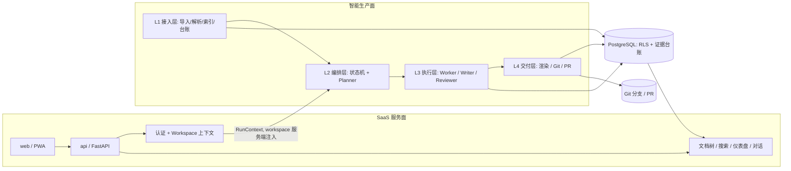
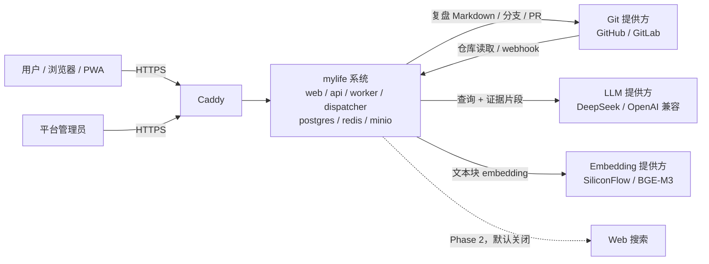
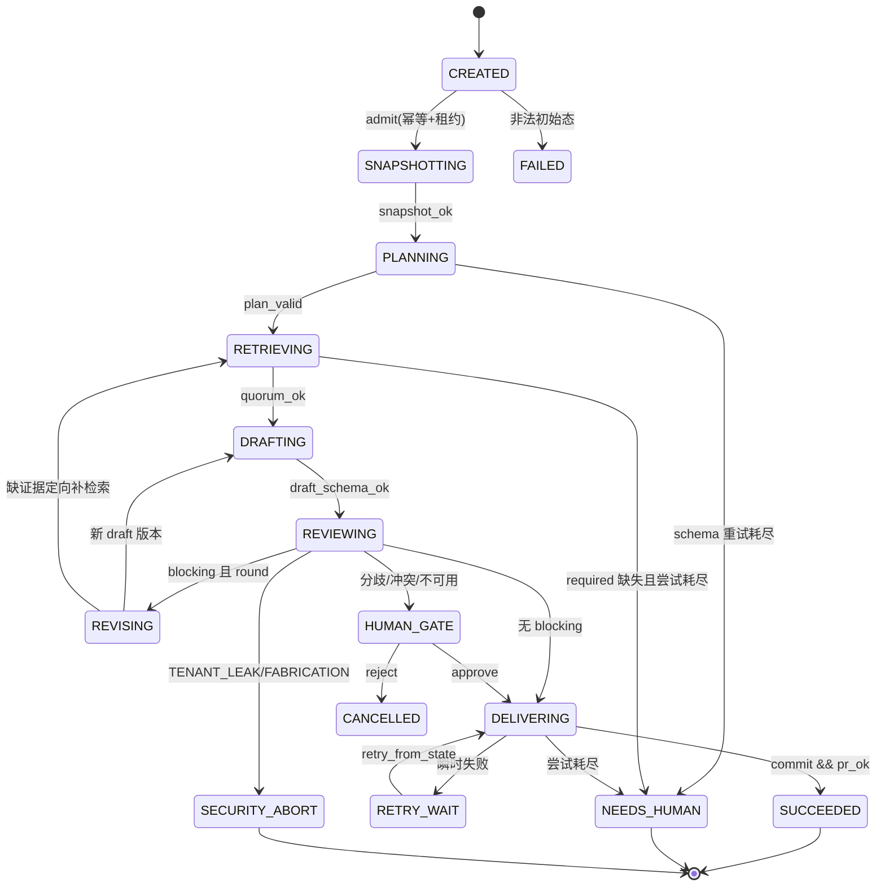

# mylife Agent 架构设计（四层四角色）

> 版本：v0.5 ｜ 日期：2026-11-06 ｜ 基线：`REQUIREMENTS.md` v1.0（已冻结）｜ 状态：设计评审稿（7 项主决策 + 5 项补充决策已拍板；非目标/反目标已明确）
>
> 决策：`1D 2B 3B 4B 5B 6A 7A`（2026-11-06，详见 `DECISIONS.md` 与附录 B）。
>
> 参考：LLM-Wiki 系 Agent Runtime（`llm-wiki-runtime`、`llm-wiki-manager/agentic-runtime`、`nvk/llm-wiki`）的机制，见第 16 章。

---

## 0. 规范文档索引

| 文档 | 作用 | 权威范围 |
|---|---|---|
| `REQUIREMENTS.md` | 需求基线 v1.0（冻结） | 功能范围、验收基线 |
| `ARCHITECTURE.md` | 架构设计（本文件） | 分层、角色、状态机、取舍 |
| `DECISIONS.md` | 7 项拍板记录 | 交付根目录、Embedding、合并、专题、预算、Reviewer、删除 |
| `DIRECTORY-CONSTRAINTS.md` | 目录与文件约束 | 代码目录、运行时目录、Git 路径、写入模式 |
| `DATA-MODEL.md` | 数据模型 | 表、列、约束、索引、RLS、迁移 |
| `API-CONTRACTS.md` | 接口契约 | HTTP、SSE、ToolGateway、Agent 契约 |
| `FRONTEND-DESIGN.md` | 前端设计系统 | tokens、布局、组件层级、页面 |
| `SECURITY-BOUNDARY.md` | 安全边界 | 信任区域、STRIDE、SEC-01–SEC-30 |
| `ACCEPTANCE-CRITERIA.md` | 可验收标准 | AC-01–AC-68、fixtures、Phase 门禁 |

冲突处理顺序：`REQUIREMENTS.md` 冻结条款 → `DECISIONS.md` → 本文件 → 各实现规范。实现规范之间冲突时，先改 `DATA-MODEL.md` / `API-CONTRACTS.md`，再回写本文件。

---

## 1. 分工确认与架构总览

### 1.1 我理解的分工

我理解你的架构是：**接入层**先把 Obsidian 知识库（Git 为主、ZIP 为辅）变成可检索、可追溯的结构化知识；**编排层**用 Agent 状态机决定“这次做什么、按什么顺序、用哪些素材、做到什么算合格”；**执行层**在已有知识中取证，关联以往复盘、专题页、wikilinks、标签与任务台账，产出带证据的复盘；**交付层**把通过门禁的产物渲染成中文目录 Markdown，用 Git 分支 + PR 交付并可回滚。

四个角色是：**Planner 只规划不取证**（章节、检索任务、预算、验收标准）；**Worker 只取证与确定性执行、不做价值判断**（导入解析、混合检索、任务台账、证据归集）；**Writer 只依据冻结证据写作、不检索**（按 kind 的固定章节，daily 7 章、逐句引用、无证据写“无记录”）；**Reviewer 只做门禁判定、不改稿**（结构、引用、可追溯、可执行性）。`orchestrator`（状态机）与 `git-gateway` 是**组件**，不是第五、第六个角色。

一句话：**Planner 决定做什么、按什么顺序、做到什么算合格；Worker 把确定的动作可靠执行并取证；Writer 只在证据账本内写作；Reviewer 只做门禁，绝不改稿。** 四者通过 `RunContext → Plan → EvidenceBundle → Draft → ReviewVerdict → DeliveryManifest` 六个对象交接，职责不渗透。

### 1.2 双平面与四层数据流

系统拆成两个平面，避免“聊天”和“复盘”各造一套流水线：

- **SaaS 服务面**：认证、Workspace、文档树、搜索、对话、仪表盘。同步、低延迟、面向浏览器。
- **智能生产面**：导入、复盘生成、Git 交付。异步、长任务、以 `run` 为单位推进。

两面共享同一 PostgreSQL（唯一事实源）与同一 `ToolGateway`（同一套检索与统计工具），只是 `ToolContext.snapshot_as_of` 不同。



文字说明：L1 持续构建知识面（documents / chunks / links / tasks / snapshots）；L2–L4 是任务面，每次请求生成一个 `agent_run`（`kind = chat | review`）。复盘走完整状态机与门禁；对话走精简分支（证据门 → 生成 → 引用闭包校验 → SSE 流式），不进入 Reviewer 热路径，以保证首 token < 3 秒。

### 1.3 五条不可协商约束

1. `workspace_id` 只来自服务端 `RunContext/ToolContext`（会话行或运行行）；HTTP 入参与工具参数模型**不声明该字段**，Pydantic `extra="forbid"`；数据库 RLS 兜底（FR-D7、NFR-1）。
2. 接入层**零生成式 LLM**：只做解析、哈希、分块、embedding、Todo 与日期抽取。LLM 仅用于可关闭的查询改写，不参与任务状态与引用判定（FR-E1、NFR-3）。
3. **证据先于写作**：Writer 只拿到冻结的 `EvidenceBundle`，无检索工具；无证据写固定哨兵，不凑内容（FR-D6、FR-E11、REQUIREMENTS §6.4）。
4. **结构化先于 Markdown**：先写 `review_sections/review_entries/review_citations`，再渲染文件；月报/年报从结构化 rollup 聚合，不重新解析散文（FR-E7/E8）。
5. **一切副作用幂等**：导入、复盘、PR 都有幂等键；同 period 覆盖同一路径、递增 version，不产生重复文件（FR-E14、NFR-4）。

### 1.4 系统边界

#### 1.4.1 系统上下文（C4 Level 1）



边界说明：

- mylife **不托管 Git**，不运行在 Obsidian 内部，不管理用户本地 Vault 的同步；它只读写一个已授权的仓库。
- mylife **不训练模型**；LLM 与 Embedding 是外部依赖，其数据保留策略属于供应商边界，需在设置页披露。
- 首版**唯一客户端是浏览器/PWA**，没有原生 App、桌面端或 Obsidian 插件。
- 平台管理员是独立的平台级角色，不进入用户 Workspace 的业务数据面（除审计与禁用等管理操作）。

#### 1.4.2 系统负责 / 不负责

| 系统负责（MVP） | 系统不负责（边界外） |
|---|---|
| Obsidian Git/ZIP 接入、解析、增量索引、混合检索 | Obsidian 客户端/插件、笔记编辑器、用户本地同步 |
| 带引用的 AI 对话、工具轨迹、会话历史 | 通用任务管理、日历、提醒、邮件客户端 |
| Todo 台账、日/月/年复盘、三个长期专题页 | 团队协作、成员权限、公开注册、计费（MVP 仅预留数据模型） |
| 仪表盘、设置、管理后台、审计、导出/删除 | Git 托管、仓库权限管理、CI/CD 平台 |
| Git 分支 + PR 交付、版本历史、合并回写 | LLM/Embedding 服务本身、模型训练、模型评测平台 |
| 多租户隔离、用量计量、预算控制 | 原生 App、第三方插件市场、复杂知识图谱可视化 |
| 中文文案与中文目录 | PDF/Office/网页剪报的深度解析（首版以 Markdown 为主） |
| 定时复盘（按 Workspace 时区） | Web 搜索（Phase 2，默认关闭） |

#### 1.4.3 数据出境与信任边界

| 边界 | 数据 | 方向 | 控制 |
|---|---|---|---|
| 浏览器 → Caddy/API | session cookie、查询、ZIP、配置 | 入 | TLS、CSRF、大小限制、登录限流 |
| API/Worker → LLM | 查询、证据片段（单 run ≤80 条）、system prompt、对话历史 | 出 | 只发必要片段；不发全库/凭据；token 预算；workspace 级开关；供应商保留策略披露 |
| API/Worker → Embedding | chunk 文本 | 出 | 批处理；不发送路径/用户身份；模型与维度可配 |
| Worker → Git 提供方 | 复盘 Markdown、commit/PR 元数据 | 出 | 最小权限 token；不发原始笔记；默认 `managed` 输出仓库 |
| Git webhook → API | push/PR 事件 | 入 | 签名校验、重放保护、幂等 delivery id |
| 笔记/历史复盘 → Agent | 正文、frontmatter、wikilinks | 入（不可信） | `<<<EVIDENCE>>>` 定界、“数据非指令”、工具只读白名单、路径白名单 |
| LLM 输出 → 系统 | Plan/Draft/Verdict JSON | 入（不可信） | schema 校验、引用闭包、确定性门禁、禁止直接写文件 |

原则：

1. **数据最小化**：只发送完成当前任务所需的片段；证据条数与 token 预算双重限制。
2. **默认不外发**：Web 搜索、第三方分析、遥测默认关闭；开启需 workspace 显式配置。
3. **可披露**：设置页展示“哪些数据会发送给哪些供应商”，以及当前 embedding/LLM 模型。
4. **可关闭**：workspace 可关闭向量检索退化为 lexical-only；Q6 允许本地 BGE-M3 兜底。

#### 1.4.4 范围边界（MVP / 延后 / 不做）

| 类别 | 内容 |
|---|---|
| **MVP 必须** | 邀请制注册、个人 Workspace、Git/ZIP 导入、混合检索、带引用对话、Todo 台账、日/月/年复盘、三个专题页、仪表盘、设置、管理后台、审计、导出/删除、Git PR 交付 |
| **延后（Phase 2+）** | 团队协作、计费、公开注册、OAuth、Web 搜索、PDF/Office 深度解析、知识图谱可视化、多 Vault、异构 Reviewer、在线换维、原生 App |
| **明确不做** | 运行在 Obsidian 内、笔记编辑器、通用任务/日历、Git 托管、模型训练、第三方插件市场、默认第三方分析/广告 |

#### 1.4.5 边界变更规则

- 新增**外部数据流**（新供应商、新出境数据）→ 必须更新本节、§10 安全表与 §14 风险表，并做隐私评审。
- 新增 **MVP 范围** → 更新 `REQUIREMENTS.md` 版本号与本文 §12/§13，不允许只改代码不改基线。
- 当前唯一未闭合的需求边界：FR-E9（`wiki/复盘`）与 REQUIREMENTS §6.3（`data/reviews`）冲突，已按决策 1D 处理（默认 `wiki/复盘`，`data/reviews` 兼容读取）。

### 1.5 非目标与反目标

#### 1.5.1 两个词的区别

| | 非目标（Non-goal） | 反目标（Anti-goal） |
|---|---|---|
| 定义 | 明确**不追求**的功能、形态或市场 | 明确**绝不能发生**的结果或行为 |
| 性质 | 范围选择，可以随版本升级转为目标 | 质量与安全底线，不能作为 trade-off 放弃 |
| 违反后果 | 范围蔓延、资源浪费、交付延迟 | 数据泄露、错误知识制度化、用户信任崩塌 |
| 变更方式 | 需求版本升级 + 架构 §12/§13 更新 + 用户确认 | 只能细化，不能删除；例外需书面风险接受 + 补偿控制 |
| 例子 | 不做原生 App | 绝不编造引用 |

一句话：**非目标回答“我们不做什么”，反目标回答“我们绝不允许发生什么”。**

#### 1.5.2 非目标

| 类别 | 非目标 | 为什么不做 | 若将来需要 |
|---|---|---|---|
| 产品形态 | 通用笔记编辑器、双链笔记应用 | Obsidian 已是编辑器；mylife 做知识生产与复盘，不替代编辑器 | 不做；只读写已授权仓库 |
| 产品形态 | Obsidian 插件 | 插件受宿主限制；多端、多租户、服务端编排需要独立系统 | 可作为客户端适配层，Phase 3+ |
| 产品形态 | 原生 iOS/Android App | PWA 覆盖首版多端；原生维护成本高 | Phase 3+ 评估 |
| 产品形态 | 公开社交、内容社区 | 隐私、审核与运营成本；产品目标是个人知识库 | 不做 |
| 协作与商业 | 团队协作、成员权限 | MVP 为个人 Workspace；数据模型预留 | Phase 2（M7） |
| 协作与商业 | 计费、支付、发票 | 首版免费邀请制（Q1） | 后续商业化阶段 |
| 协作与商业 | 公开注册 | 邀请制控制质量、容量与滥用（Q1/Q2） | 后续 |
| 协作与商业 | 企业 SSO | 首版邮箱密码 + 邀请码（Q4） | 后续 |
| 知识处理 | PDF/Office/网页剪报深度解析 | 首版以 Markdown 为主（REQUIREMENTS §2.2） | Phase 2+ |
| 知识处理 | 复杂知识图谱可视化 | 首版只存链接与基础关联（§2.2） | Phase 2+ |
| 知识处理 | 通用 Web 搜索 | 检索边界是个人知识库；外部搜索引入来源与合规问题 | Phase 2，默认关闭 |
| 知识处理 | 多 Vault | 首版单 Vault；多 Vault 涉及权限、索引与配额隔离 | Phase 2+ |
| 平台能力 | Git 托管、CI/CD | 复用 GitHub/GitLab；不造代码托管平台 | 不做 |
| 平台能力 | 模型训练、微调、评测平台 | 使用外部 LLM/Embedding；不承担模型生命周期 | 不做 |
| 平台能力 | 第三方插件市场 | 首版无插件生态（§2.2） | 不做 |
| 平台能力 | 通用任务管理、日历、提醒 | Todo 只作为复盘素材，不做 GTD 产品 | 不做 |
| 交付形态 | 实时协同编辑 | 单人 Workspace；协同属于团队阶段 | Phase 2+ |
| 交付形态 | 离线优先全功能 | PWA 首屏可用，但生成、检索、交付依赖服务端 | 不做 |
| 组织形态 | 万能 Agent、单 Agent 包打天下 | 四角色 + 确定性状态机；避免不可控的自由循环 | 不做 |
| 组织形态 | 先建平台、再找场景 | 与 LLM-Wiki 双循环相反；先用真实任务验证 | 不做 |

#### 1.5.3 反目标

反目标不是口号，每条都必须有**可执行门禁**与**违反处置**。

**A. 正确性与可信度**

| # | 反目标 | 为什么危险 | 硬约束/门禁 | 违反处置 |
|---|---|---|---|---|
| A1 | 绝不在没有证据时编造结论或引用 | 错误知识制度化，用户无法信任 | G5/G7；无证据哨兵；`fx_empty_day`；引用闭包 | blocking 回 REVISING；`FABRICATION` → `SECURITY_ABORT` |
| A2 | 绝不把“没有记录”写成“没有发生” | 复盘失真，误导行动 | 7 条哨兵；G7；空日 fixture | blocking |
| A3 | 绝不让 LLM 判断 Todo 完成状态 | 语气推测不可靠，污染台账 | 只认 Markdown 复选框（FR-E1）；解析器单测 | 解析失败隔离，不猜 |
| A4 | 绝不让历史复盘作为原始证据自我引用 | 模型自我强化，形成幻觉闭环 | 历史复盘只作指针；`source_type=generated` 排除；PRIOR_REVIEW 回链原始 chunk | blocking |
| A5 | 绝不让 Reviewer 改稿或放行安全事件 | 门禁失效，错误直接入库 | Reviewer 只读；`TENANT_LEAK/FABRICATION` 不可人工放行 | `SECURITY_ABORT` |

**B. 知识治理**

| # | 反目标 | 为什么危险 | 硬约束/门禁 | 违反处置 |
|---|---|---|---|---|
| B1 | 绝不绕过 Runtime 直接写长期知识 | 路径、权限、审计失控 | §16.4 四道门；所有写入经 Runtime；Agent 无写权限 | 拒绝写入 + 审计 |
| B2 | 绝不静默摄入敏感或未经确认的数据 | 隐私与信任风险 | 四道门“获授权/确认”；专题首见人工确认（决策 4B） | 转人工或丢弃 |
| B3 | 绝不让动态状态写进静态契约 | 配置漂移、不可复现 | 静态 profile vs 运行时 settings；启动按 kind fail-fast | 拒绝启动 |
| B4 | 绝不让知识库异常阻断复盘主流程 | 可用性失败，用户被“增强”拖累 | `evidence_only` 降级；`degraded` 事件可见 | 降级交付，不判失败 |
| B5 | 绝不在真实证据出现前扩建平台 | 过度设计，复杂度失控 | 双循环；Phase 退出标准；Golden fixtures | 回退范围，先补证据 |

**C. 租户与安全**

| # | 反目标 | 为什么危险 | 硬约束/门禁 | 违反处置 |
|---|---|---|---|---|
| C1 | 绝不跨 Workspace 读写 | 严重安全缺陷（NFR-1） | RLS `FORCE` + 应用层 + 复合外键 + 每表集成测试 | `SECURITY_ABORT`，不可人工放行 |
| C2 | 绝不把笔记内容当指令 | Prompt injection、外链外泄 | `<<<EVIDENCE>>>` 定界、“数据非指令”、工具只读白名单、路径白名单 | blocking + 安全事件 |
| C3 | 绝不泄露凭据或密钥 | 账号接管、仓库被写 | 信封加密、日志脱敏、错误不回显 token | 轮换 + 审计 + 告警 |
| C4 | 绝不 force push 或重写 Git 历史 | 破坏协作与审计 | PR-only；分支保护；禁止 force push | 操作拒绝 + 告警 |
| C5 | 绝不接受无签名或可重放的 webhook | 伪造交付状态 | 签名校验 + `delivery_id` 幂等 | 拒绝 + 告警 |

**D. 交付与成本**

| # | 反目标 | 为什么危险 | 硬约束/门禁 | 违反处置 |
|---|---|---|---|---|
| D1 | 绝不为同一 period 产生重复文件或重复 PR | 版本混乱，用户无法判断哪份为准 | 唯一路径 + 幂等键 + open PR 复用 | 覆盖/复用，不新建 |
| D2 | 绝不让自动合并绕过 Gate | 错误内容直接进入长期知识 | 决策 3B：daily opt-in + Gate 全通过；monthly/yearly 人工 | 阻止合并 |
| D3 | 绝不让成本无上限 | 账单失控 | 决策 5B：预算跨重试累计 + 80% 告警 + 100% 硬停 | 终止为 `FAILED/NEEDS_HUMAN` |
| D4 | 绝不静默降级或静默丢事件 | 用户误判完整性 | `degraded` 事件 + UI 横幅 + PR 首行标注 + `usage_events.degraded` | 显式告知 |
| D5 | 绝不让可视化或架构图成为事实源 | 事实漂移，图与数据不一致 | PostgreSQL 唯一事实源；图只读、可重建 | 以 DB 为准 |

**E. 产品体验与工程方法**

| # | 反目标 | 为什么危险 | 硬约束/门禁 | 违反处置 |
|---|---|---|---|---|
| E1 | 绝不让用户必须学 YAML 或 CLI | 采用门槛过高 | 设置页与自然语言交互；CLI 仅运维使用 | 产品评审 |
| E2 | 绝不让增强失败阻断原业务 | 用户被“智能”拖累 | Wiki 可选后端；降级矩阵；`evidence_only` | 降级，不失败 |
| E3 | 绝不用“记忆”补偿不成熟的流程 | 掩盖缺陷，越补越乱 | 先固化流程与契约，再加记忆；dossier 只作聚合视图 | 回退记忆层，修流程 |
| E4 | 绝不把 Prompt 当硬保证 | 模型不稳定，规则会漂移 | 关键约束全部落到代码/DB/门禁，Prompt 只做提示 | 改为确定性实现 |
| E5 | 绝不在没有真实证据前宣布成功 | Demo 冒充能力，后续返工 | Golden fixtures + 真实任务验收 + Phase 退出标准 | 回到 Phase，补证据 |

#### 1.5.4 反目标的执行位置

| 反目标组 | 主要执行位置 | 验证方式 |
|---|---|---|
| A 正确性 | §4.4 revise、§9.1 G0–G9、§9.3 fixtures | `fx_daily` / `fx_empty_day` / `fx_injection` |
| B 知识治理 | §7.3 专题合并、§16.4 四道门、§16.9 fail-fast | 专题重跑测试、契约启动校验 |
| C 租户与安全 | §10 安全表、§2.5 RLS 注入、§8.5 凭据 | 跨租户集成测试、注入 fixture、webhook 重放测试 |
| D 交付与成本 | §4.3 幂等、§8.3 版本、§9.4 预算、§16.7 事件 | 并发重跑测试、预算超限测试、cursor 断线测试 |
| E 体验与方法 | §1.3 约束、§16.1 原则、§13 落地顺序 | 真实任务验收、Phase 退出评审 |

#### 1.5.5 变更规则

1. **非目标 → 目标**：必须更新 `REQUIREMENTS.md` 版本号、本文 §12 追溯矩阵与 §13 落地顺序，并记录变更原因；不能只改代码不改基线。
2. **反目标**：只能细化或新增，不能删除。任何例外必须是**书面风险接受**，带期限、补偿控制、审计记录，并写入 `DECISIONS.md`；不接受口头豁免。
3. **事故驱动**：发生一次反目标违反，必须新增对应回归测试，并在本节追加一条反目标或强化现有门禁。
4. **评审口径**：任何“为了赶进度先放一放”的提议，如果触碰 A–E 任一条，默认拒绝；需要走例外流程，而不是默认通过。

## 2. 逐层设计

### 2.1 接入层（L1 Ingest）

| 项 | 内容 |
|---|---|
| 职责 | Git/ZIP 拉取、忽略过滤、Markdown 解析、内容哈希、分块、embedding、Todo 与日期抽取、变更历史记录 |
| 输入 | 仓库地址/分支/凭据、Vault ZIP、定时或手动触发、workspace 配置 |
| 输出 | `source_snapshot`（commit SHA + 文档哈希清单）、documents/chunks/links、`task_occurrences`、`document_dates`、`document_changes`、`job_runs` 状态 |
| 组件 | `ingest-connector`（Git/ZIP 适配器）、`ignore-matcher`、`markdown-parser`、`chunker`、`indexer`、`task-ledger-builder` |
| 关键流程 | 获取 → 解包 → 忽略 → 解析（frontmatter/标题/标签/wikilink/复选框/日期）→ 哈希 → upsert → 分块 → 索引 → 报告 |
| 对应 FR | FR-B1~B8、FR-E1/E2/E4、FR-C2/C6、NFR-3 |
| 边界（不做） | 不生成自然语言、不判断复盘价值、不写 reviews、不调用生成式 LLM |
| 失败处理 | 单文件失败隔离并记录 `job_items`；重试 3 次指数退避；只重跑失败文件；整批部分成功 |

确定性规则：哈希 = `sha256(parser_version + normalized_body + canonical_frontmatter)`，**路径不参与哈希**；块级哈希用于增量 embedding。Git 源用 `git diff --name-status A..B` 做增量，业务日期取 **commit author_date / frontmatter / 文件名**，**禁止用 mtime**（clone 后 mtime 全是 checkout 时间）。路径移动用 rename 语义迁移 `document_id` 与 chunk，不重建 embedding。

### 2.2 编排层（L2 Orchestration）

| 项 | 内容 |
|---|---|
| 职责 | 准入与幂等、快照固定、Planner 规划、状态推进、预算、人工门、调度 |
| 输入 | `JobRequest`（手动/定时/对话/API）、workspace 配置、上一版状态 |
| 输出 | `Plan`、`agent_run` 状态与 `run_events`、角色任务、SSE 事件、用量 |
| 组件 | `orchestrator`（FSM 引擎）、`planner`（角色运行时）、`scheduler`（DB 驱动 dispatcher）、`budget-guard`、`tool-registry` |
| 关键流程 | 准入（幂等 + advisory lock）→ 固定快照 → 规划 → 派发 → 门禁 → 交付 → 记录 |
| 对应 FR | FR-E12/E13/E14、FR-D1/D4/D8、§8.3 |
| 边界（不做） | 不实现检索 SQL、不写正文、不直接 commit、不信任 LLM 传入的 `workspace_id` |
| 失败处理 | 计划 schema 修复 2 次 → 固定模板兜底；预算超限 → FAILED/NEEDS_HUMAN；租约过期由 sweeper 回收 |

### 2.3 执行层（L3 Execution）

| 项 | 内容 |
|---|---|
| 职责 | 混合检索、证据装配、知识关联、写作、门禁判定 |
| 输入 | `Plan`、`source_snapshot`、历史 reviews/topic_entries、任务台账 |
| 输出 | `EvidenceBundle`、`Draft`、`ReviewVerdict`、claims 与引用 |
| 组件 | `retrieval-service`、`evidence-assembler`、`knowledge-linker`、`writer-service`、`reviewer-gate`、`tool-executor` |
| 关键流程 | 并行检索 → 去重装配（单章节 ≤12 条、全局 ≤80 条）→ Writer 分章写作 → Reviewer 统一调确定性服务执行 G0–G9（G1/G2 不是独立阶段） |
| 对应 FR | FR-C1~C6、FR-D3~D6、FR-E1~E11、REQUIREMENTS §6.2/§6.4 |
| 边界（不做） | 不决定目标、不触碰 Git、不跨 workspace 取数、不定义新统计口径 |
| 失败处理 | 单任务重试 1 次；required 全失败 → 章节 `degraded`；Writer schema 失败重写 2 次；Reviewer 不可用 → fail-closed 转人工 |

### 2.4 交付层（L4 Delivery）

| 项 | 内容 |
|---|---|
| 职责 | 路径解析、Markdown 渲染、专题重渲染、Git 分支/提交/PR、版本登记、合并回写 |
| 输入 | `DeliveryManifest` + `Draft` + `ReviewVerdict` |
| 输出 | commit、PR、`delivery_records`、`review_versions`、审计日志 |
| 组件 | `delivery-service`、`path-resolver`、`renderer`、`git-gateway`、`webhook-receiver` |
| 关键流程 | 路径解析 → 渲染 → 分支 → commit → push → PR → 合并 → webhook 回写 → 重索引 |
| 对应 FR | FR-E9/E10/E14、FR-A7、FR-G4、NFR-9 |
| 边界（不做） | 不改写语义、不发布未过门禁内容、不写路径白名单之外的文件、不 force push |
| 失败处理 | 凭据失效 → `blocked` + 产物可下载；PR API 失败重试 3 次保留分支；冲突 → 人工；Git 不可用 → `ui_diff` 降级 |

### 2.5 SaaS 服务面（api 路由域，非独立微服务）

与 §11 一致：仍是一个 FastAPI `api` 容器，内部按域拆 router + service 层，**不新增部署单元**。所有域共享同一套认证、`RunContext` 与 RLS 注入；区别只在是否触发长任务。

| 域 | 职责 | 输入（HTTP） | 输出 | 对应 FR | 失败处理 |
|---|---|---|---|---|---|
| auth | 注册、登录、登出、退出所有设备、会话续期、登录限流 | `POST /auth/register`、`/auth/login`、`/auth/logout`、`/auth/logout-all` | HttpOnly Cookie、`sessions` 行 | A1/A2/A6 | 限流 429 + 指数锁定；密码错误统一文案 |
| workspace | 列表、创建、切换、成员与角色 | `GET/POST /workspaces`、`POST /workspaces/{id}/switch` | Workspace 列表、`active_workspace_id` | A3/A4/A5 | 非成员返回 404；切换校验成员关系 |
| document | 目录树、正文、元数据、图片、Markdown 渲染 | `GET /documents/tree`、`GET /documents/{id}` | 树 / 渲染 HTML / 元数据 | B6/B7/F4 | 单文件解析失败不阻塞树；路径越界 404 |
| ingest | Git 连接/手动同步、ZIP 上传、导入任务状态与重试 | `POST /ingest/git`、`POST /ingest/zip`、`POST /ingest/sync`、`GET /ingest/jobs/{id}`、`POST /ingest/jobs/{id}/retry` | `job_runs`、进度事件 | B1/B2/B8 | 单文件失败隔离；重试只跑失败文件；ZIP 超限 413 |
| search | 混合检索、四类过滤器、高亮、全局搜索（笔记 + 复盘独立索引） | `GET /search?q=&filters=` | `SearchResult[]`（§2.6） | C1–C6/F4 | embedding 超时降级 lexical-only 并标 `degraded` |
| chat | 会话 CRUD、消息、SSE run、引用、上下文配置 | `POST /conversations`、`POST /conversations/{id}/turns`、`GET /runs/{id}/events` | SSE、`messages` | D1–D9 | LLM 不可用 → 哨兵 + `degraded`；流中断标 `partial` |
| review | 手动触发日/月/年复盘、查询 run、审批门、交付状态 | `POST /reviews`、`GET /reviews/{id}`、`GET /runs/{id}`、`POST /runs/{id}/approve`、`POST /runs/{id}/reject`、`GET /deliveries` | run_id、状态、PR | E12/E13/E14 | 活跃 run 返回 409 + 现有 run_id；审批校验 `workspace_members` |
| dashboard | 最新复盘、任务面板、复盘日历、完成率 | `GET /dashboard/latest`、`/dashboard/tasks`、`/dashboard/calendar`、`/dashboard/stats` | 结构化只读视图（60s 缓存） | F1–F4 | 只读表 + 缓存，不调 LLM；缓存失效降级直查 |
| settings | LLM/Embedding/定时/Git/用量设置 | `GET/PUT /settings/*` | 配置、测试连接结果 | G1–G5 | 凭据测试失败不保存；解密失败告警 |
| admin | 用户、Workspace、邀请码、禁用、系统配置 | `/admin/*` | 列表、审计 | G6/A7 | `platform_admin` 双重校验 + `audit_logs` |
| export-delete | Workspace 导出 ZIP、账号/Workspace 删除（30 天冷却） | `POST /exports`、`DELETE /workspace` | `export_jobs`、`deletion_requests` | G7/NFR-9 | 异步可重试；冷却期内可撤销；purge 覆盖 DB/MinIO/向量/凭据 |

**`create_review` 的确认协议**：chat 内调用该工具不直接写；先返回 `{preview, kind, period_key, confirmation_token}`，用户确认后由 L2 以 `POST /reviews` 异步入队并返回 `run_id`；review run 内禁止递归创建 review（§3.5）。

**会话 → RunContext → RLS 注入**（每个请求必经）：

```mermaid
sequenceDiagram
  participant C as Browser
  participant A as api (FastAPI)
  participant S as sessions/workspace_members
  participant P as PostgreSQL
  C->>A: HttpOnly Cookie (session token)
  A->>S: 校验 token_hash + token_version + expires_at
  S-->>A: user_id, active_workspace_id, role
  A->>S: 校验 active_workspace_id ∈ workspace_members
  A->>A: 构造 RunContext(user_id, workspace_id, role, request_id)
  A->>P: BEGIN; set_config('app.workspace_id', :ws, true)
  A->>P: 业务查询（RLS 自动过滤）
  A->>P: COMMIT（连接归还时复位）
  A-->>C: 响应；跨租户统一 404
```

- `sessions` 表：`id, user_id, token_hash, token_version, active_workspace_id, expires_at, revoked_at`；“退出所有设备”即 `token_version += 1`，旧 token 全部失效（FR-A6）。
- 首版角色仅 `owner` + `platform_admin`；`admin/member` 仅数据模型预留（FR-A5）。
- `body/header/query` 一律不声明 `workspace_id`；跨租户访问统一返回 **404** 而非 403，避免探测。

### 2.6 检索服务（retrieval-service）

`search_notes` 工具、SaaS 搜索页、chat 精简分支、Worker 取证**共用同一服务**，禁止三套检索。

**契约**（§5 同步定义 `SearchQuery` / `SearchResult`）：必含 FR-C5 五字段 `path/title/heading/snippet/score`，另加 `source_type(document|review)`、`document_id/chunk_id/review_id`（按来源类型必填其一）、`line_range/matched_by(lexical|vector|both)/rank_lexical/rank_vector/occurred_on`。

**复盘检索（FR-F4）**：`review_search` 是独立索引，仅保留 current version；首版 lexical-only（同一 jieba 两段式 + tsv），不参与向量路；结果 `source_type=review`、`review_id` 必填、`document_id/chunk_id` 为 NULL。搜索页默认 `source_type=both`，可切换“笔记 / 复盘”。

**分词与 tsv（两段式，纠正“生成列直接调 jieba”的不可行做法）**：
1. ingest 侧用固定版本 jieba（`cut_for_search`）把正文切成空格连接的 `search_text` 普通列；
2. `tsv tsvector GENERATED ALWAYS AS (to_tsvector('simple', search_text)) STORED`；
3. 查询侧用**同一词典版本**切 query，拼 `to_tsquery('simple', 'tok1 & tok2')`（召回不足时放宽为 `|`）；
4. `tokenizer_version` 并入 `parser_version` 并参与内容哈希；词典升级触发 tsv 全量重建。

**融合（确定性 RRF，k=60）**：`score(d) = Σ_i 1/(60 + rank_i(d))`，rank 从 1 起。三路候选：tsv 词法 top50、pgvector 余弦 top50、title/path 命中 top20；按 `chunk_id` 去重后求和，取 `top_k`；排序键 `(score desc, path asc, chunk_ordinal asc)` 保证重跑一致。**不用加权和**（两路分数不可比），标题/路径权重改为独立一路进入 RRF。

**四类过滤器**（召回前 WHERE 预过滤）：

| 过滤器 | 谓词 | 索引 |
|---|---|---|
| 目录 | `path LIKE concat(:prefix, '%')`（或 ltree `<@`） | `btree(path text_pattern_ops)` |
| 标签 | `tags && ARRAY[:tags]` | `GIN(tags)` |
| 日期范围 | `occurred_on BETWEEN :from AND :to`（业务日期，禁用 mtime） | `btree(workspace_id, occurred_on)` |
| 文件类型 | `extension = ANY(:ext)`（path 派生列，白名单 md/markdown） | `btree(workspace_id, extension)` |

向量侧开 `hnsw.iterative_scan=relaxed_order` 并限 `max_scan_tuples`，避免“先 top-k 后过滤”造成召回塌陷。

**snippet 与高亮**：`ts_headline('simple', 片段原文, tsquery, 'StartSel=<mark>,StopSel=</mark>,MaxWords=40,MinWords=15')`，中文按 token 边界切窗；**先 HTML 转义再插标记**（防 XSS）。SaaS 返回 `snippet_html`，工具/Writer 返回纯文本 `snippet`。

**性能预算**（10k 文档 / 约 80k chunk，P95 < 1s，不含 LLM）：鉴权+上下文 5ms、jieba 15ms、query embedding 120ms（缓存命中 0ms）、tsv 词法 60ms、HNSW 60ms、融合去重 10ms、snippet 80ms、序列化 10ms，合计约 360ms，留 2.5× 余量。embedding 超 250ms 降级 lexical-only 并标 `degraded=vector_timeout`；`search_latency_p95{stage}` 分阶段埋点。

**Embedding 维度与换模（FR-G2，决策 2B）**：pgvector 列维度固定，禁止原地改维。`embedding_profiles` 表记录 `workspace_id, provider, model, dimension, index_name, status, created_at`；换维只走蓝绿迁移：新 profile → 新 `document_chunks_v{n}` 表 + 新 HNSW 索引 → 全量 re-embed → 覆盖率校验 → 原子切换 `workspace_settings.embedding_profile_id` → 旧表延迟删除。MVP 只允许首配（默认 BGE-M3 1024 维），在线换维作为运维任务，不在请求路径上。

## 3. 逐角色设计

### 3.1 Planner

- **定位**：把 Job 拆成章节骨架与检索计划，决定关联哪些历史知识、给多少预算。
- **职责**：解析 period 与时区、按 kind 生成 §5.1 对应章节骨架、产出检索任务、选择关联目标、定义验收标准与预算。
- **输入**：`JobRequest`、`SnapshotRef` 元数据、workspace settings、统计计数、上一版问题清单（**仅元数据，不读正文**）。
- **输出**：`Plan`（sections、tasks、correlations、budget、acceptance）。
- **工具**：只读元数据类 `get_stats` / `list_tasks`（仅计数与聚合），**无 search_notes、无 read_note、无写工具**。
- **禁止**：不读笔记正文、不引用具体片段作结论、不发自由 SQL、不写正文。
- **失败与重试**：schema 修复 2 次；仍失败走固定模板计划（daily 七章 DAG 硬编码）。
- **交互**：向 orchestrator 交付 Plan；向 Worker 下发 tasks；不直接与 Writer/Reviewer 通信。

### 3.2 Worker

- **定位**：确定性的执行者与取证者，产出可回放的证据。
- **职责**：导入全流程；执行 `search_notes/read_note/list_tasks/get_review/get_stats`；任务台账聚合；按 Plan 并行取证、去重、标注缺口。
- **输入**：导入任务，或 `Plan` + `ToolContext`。
- **输出**：`source_snapshot`、`EvidenceBundle`（**由代码装配，非 LLM 生成**）、`ExtractionReport`（含丢弃项与原因）。
- **工具**：DB（RLS）、MinIO、Embedding API、Git 只读、检索工具；**无生成式 LLM、无写工具**。
- **禁止**：不总结、不下价值判断、不生成 evidence_id 之外的标识、不推断 Todo 状态。
- **失败与重试**：Celery 重试 3 次 + 指数退避；文件级失败隔离；幂等 upsert；失败写 `job_runs` 可见。
- **交互**：接收 Plan；向 Writer 交付冻结的 EvidenceBundle；向 Reviewer 提供原文复核。

### 3.3 Writer

- **定位**：只在证据账本内表达。
- **职责**：按 §5.1 对应 kind 的章节写作（字段语义见 REQUIREMENTS §6.2）；每条结论绑定 `evidence_id`；无证据写固定哨兵；周/年只做聚合叙述。
- **输入**：`Plan` + `EvidenceBundle` + 上一版结构（仅风格与结构，**事实必须重新绑定本 run 证据**）。
- **输出**：`Draft`（sections + claims + 引用 + unsupported 列表）。
- **工具**：仅 `expand_evidence(evidence_id, window)`（在 bundle 内扩展上下文）；**无检索、无写 DB、无 Git**。
- **禁止**：不得自行检索、不得引入外部知识、不得推测 Todo 完成状态、不得复制上一版未取证事实。
- **失败与重试**：schema 校验失败修复 2 次；超时重试 2 次；仍失败该章写哨兵并标记 degraded。
- **交互**：接收 Reviewer 的 `must_fix[]` 产新版本；不直接改文件。

### 3.4 Reviewer

- **定位**：唯一的交付门禁，只判不改。
- **职责**：确定性规则（章节完整、引用可解析、quote 复算、日期路径可追溯、行动可执行、租户/路径/注入）；可选 LLM judge 只给 warning。
- **输入**：`Draft` + `EvidenceBundle` + rubric。
- **输出**：`ReviewVerdict`（decision、blockers、warnings、fingerprint）。
- **工具**：`check_citation`（确定性服务）、`resolve_evidence`、`read_note`（只读复核）、`get_stats`；**无写权限、无 Git 权限**。
- **禁止**：不得改写稿件、不得输出新正文、不得放宽 blocking 规则、不得放行 `TENANT_LEAK/FABRICATION`。
- **失败与重试**：规则引擎异常 → 降级人工门，不默认通过；blocking 回 Writer 的轮次不超过 §4.4 / §5 `REVISION_LIMIT[kind]` 的上限。
- **交互**：向 orchestrator 返回 verdict；向 Writer 返回 must_fix；向交付层返回放行信号。

### 3.5 分工总表

| 维度 | Planner | Worker | Writer | Reviewer |
|---|---|---|---|---|
| 所属层 | L2 | L1 + L3 | L3 | L3 门禁 |
| 决策权 | 计划/预算/验收 | 取证策略 | 表达结构 | 放行/打回 |
| 写权限 | 无 | 导入表 + 证据表 | 无（只产 Draft） | 无 |
| 检索权限 | 无 | 有 | 无（仅 expand） | 只读复核 |
| 可否调 LLM | 是（结构化输出） | 否（仅可选查询改写） | 是 | 是（仅 warning） |
| 失败上限 | 2 次 schema | 3 次重试 | 2 次重写 | ≤ `REVISION_LIMIT[kind]` |
| RACI（复盘） | R | R | R | A |

纪律：**Reviewer 不写、Writer 不判、Planner 不执行、Worker 不做价值判断**。`create_review` 是唯一写工具，只能由 L2 在用户确认后异步入队，且禁止 review run 内递归创建 review。

## 4. Agent 状态机

### 4.1 状态表

| 状态 | 含义 | 守卫 | 超时 | 最大尝试 |
|---|---|---|---|---|
| CREATED | 已准入 | 复盘类：幂等键无活跃 run，workspace 复盘并发 ≤2；chat 不占该槽（见 §4.6） | 30s | 1 |
| SNAPSHOTTING | 固定素材快照 | `index_lag_sec ≤ 1800` 或 force_refresh | 90s | 3 |
| PLANNING | Planner 产出 Plan | 章节集合与 ordinal 等于 §5.1 对应 kind 常量；required 章节 ≥1 task；预算内 | 180s | 2 |
| RETRIEVING | Worker 取证 | required task 成功或可标注 degraded | 420s | 3 |
| DRAFTING | Writer 写作 | schema 合法；未知 evidence_id = 0；行动为 `- [ ]` | 240s | 2 |
| VERIFYING | chat 引用闭包校验（仅 chat） | 每个引用序号解析到本 run 冻结 chunk；失败改写哨兵 | 60s | 1 |
| REVIEWING | 复盘门禁（仅 review） | 确定性规则 + 可选 judge | 180s | 2 |
| REVISING | 按 must_fix 重写 | 轮次未超；问题指纹变化 | 180s | 1 |
| HUMAN_GATE | 人工审批 | 审批人属于该 workspace | 72h | — |
| DELIVERING | 渲染 + Git | 路径白名单；content_hash 校验 | 180s | 3 |
| SUCCEEDED | 已交付 | commit 成功且 PR 成功或 local 模式 | — | — |
| RETRY_WAIT | 瞬时失败等待重试 | `retry_from_state` 非空；退避未到期 | 60s | 3 |
| NEEDS_HUMAN | 可恢复死信 | 人工介入 | — | — |
| SECURITY_ABORT | 安全终止 | `TENANT_LEAK/FABRICATION`，不可人工放行 | — | — |
| FAILED / CANCELLED | 终止 | — | — | — |

### 4.2 转移图



### 4.3 幂等、并发与续跑

- **三把索引，而非一把**（`kind` 含 chat 时不能共用 `(workspace,kind,period_key)`，否则所有会话退化为同一把键）：
  1. **复盘活跃唯一**：`UNIQUE (workspace_id, kind, period_key) WHERE kind IN ('daily','monthly','yearly') AND state IN (<活跃态>)`；活跃态集合抽成单一 DB 函数 `is_active_state(state)`，禁止在四处各写一遍。
  2. **chat 会话内串行**：`UNIQUE (workspace_id, conversation_id) WHERE kind='chat' AND state IN ('created','retrieving','drafting','verifying')`；新 turn 到来时优先显式取消旧 run（`CANCELLED + chat.cancelled`），409 仅作兜底。不同 `conversation_id` 必须允许并发。
  3. **chat 同 turn 幂等**：`UNIQUE (workspace_id, conversation_id, client_turn_id)`；`client_turn_id` 由客户端每次“发送”生成并在重试时复用，**不要**用服务端自增 turn_index 当幂等键（超时重发会拿到新值，导致重复回答）。
- **版本键**：产物版本 `(workspace_id, kind, period_key, version)` 唯一，version 由 DB 序列/CAS 分配；`attempt_id` 只记录重试，不参与逻辑去重。
- **准入原子化**：`INSERT ... ON CONFLICT` + `pg_try_advisory_xact_lock(hashtextextended(...))`；已有 SUCCEEDED 时手动触发创建 v(n+1)；活跃时返回 409 + 现有 run_id。
- **CAS 迁移**：`UPDATE agent_runs SET state=:to WHERE id=:id AND state=:from AND lease_owner=:owner`，防止重复投递双执行。
- **租约与续跑**：`lease_expires_at = now()+90s`，每次迁移续租；sweeper 每分钟回收僵尸 run 到 `RETRY_WAIT` 并记录 `retry_from_state`；handler 以 `state_payload` 重入，不重放历史状态；Celery `acks_late=True`、`task_reject_on_worker_lost=True`。
- **退避**：1s/4s/16s，上限 60s；不用无限 autoretry。

### 4.4 revise 循环与收敛

轮次上限取 §5 的 `REVISION_LIMIT[kind]`：daily 2、monthly 2、yearly 3；`RunOptions.max_revisions` 不得高于该表。继续修订需**同时满足**：轮次未超 + 违规集合指纹变化 + 确定性 blocker 数下降（分数仅参考）。任一不满足 → `ESCALATE → HUMAN_GATE`，避免无限打转与越改越差。缺证据时走 `REVISING → RETRIEVING` 定向补检索，并计入一轮。

### 4.5 人审门与死信

- **触发**：Reviewer 分歧、冲突、评审不可用；yearly 默认人工；轮次耗尽；`TENANT_LEAK/FABRICATION` 走独立 `SECURITY_ABORT`，**禁止任何人工放行**。
- **NEEDS_HUMAN 载荷**：`{reason_code, state, draft_id, verdict_id, retryable, trace_id}`；UI 提供“原样通过 / 编辑后通过 / 放弃”；通过后从 `HUMAN_GATE → DELIVERING` 继续，写 `audit_logs`。
- **降级矩阵**：LLM 不可用 → 转人工，不得占位冒充成功；部分检索失败 → `degraded` 并写“本节数据不完整”；当日确实无素材 → 全章节哨兵，正常交付；Git 不可用 → 本地/对象存储交付，不判失败。
- **人审门审批人校验**：`HUMAN_GATE` 的 approve/reject 必须查询 `workspace_members`，确认审批人属于该 workspace 且 role ∈ {owner, admin}；`platform_admin` 代操作需写 `audit_logs` 并二次确认。

### 4.6 chat 精简分支（不进入复盘门禁）

chat 与 review 共享 `agent_runs` / `run_steps` / `run_events` 与 `ToolGateway`，但**不进入** PLANNING / REVIEWING / REVISING / HUMAN_GATE / DELIVERING，也不写 `reviews` / `review_versions`。

| 项 | 规则 |
|---|---|
| 状态 | `CREATED → RETRIEVING（有界工具循环，最多 4 轮 / 10 次工具调用，单工具 10s 超时）→ DRAFTING（生成 + SSE 流式）→ VERIFYING（引用闭包校验）→ SUCCEEDED / FAILED / CANCELLED` |
| 引用闭包 | 每个引用序号必须解析到本 run 冻结的 chunk；解析失败改写为“无记录”哨兵，不得保留悬空引用（FR-D3/D6） |
| 预算 | 首 token < 3s 是 SLO 而非硬保证（FR-D1 原文为“尽量”）；单 turn 总墙钟 60s，流式上限 120s；LLM 瞬时错误仅在首 token 前重试 ≤2，已开始流式后失败不重试，发 `chat.error` 并标 `partial` |
| 事件 | `chat.tool_call / chat.tool_result / chat.citation / chat.done / chat.error / chat.cancelled`；沿用 §16.7 的 cursor + epoch |
| 数据 | token delta 仅 SSE、不持久化；最终消息与引用写 `messages`；工具轨迹同时写 `run_steps`（FR-D5） |
| 并发 | 按会话串行（§4.3 索引 2）；per-workspace 速率限制；不占复盘并发槽 |

## 5. 数据契约

```python
SectionId = Literal[            # 仅 daily
    "today_tasks", "learning_summary", "journal_events", "mistakes",
    "methods", "tomorrow_actions", "one_line_summary",
]
MonthlySectionId = Literal[
    "completion_rate", "recurring_mistakes", "method_landing", "next_week_actions",
]
YearlySectionId = Literal[
    "learning_map", "event_timeline", "top_mistakes", "method_system", "next_year_direction",
]

REVISION_LIMIT: dict[str, int] = {   # 按 kind 的权威上限（§4.4）
    "daily": 2, "monthly": 2, "yearly": 3,
}

class RunOptions(BaseModel):
    max_revisions: int | None = None     # None = 取 REVISION_LIMIT[kind]；显式值不得高于表上限
    require_human: bool = True
    model_profile: str = "default"
    budget: Budget
    retrieval_top_k: int = 20            # FR-D9
    context_window_tokens: int = 32_000  # FR-D9
    web_search_enabled: bool = False     # FR-D9，首版关闭

class ReviewJobRequest(BaseModel):
    run_id: UUID
    workspace_id: UUID          # 服务端注入，请求体不暴露
    kind: Literal["daily","monthly","yearly"]
    period_key: str             # YYYY-MM-DD | YYYY-MM(ISO) | YYYY | topic_key
    timezone: str
    trigger: Literal["manual","schedule","api"]
    options: RunOptions

class ChatTurnRequest(BaseModel):
    run_id: UUID
    workspace_id: UUID          # 服务端注入
    conversation_id: UUID
    client_turn_id: UUID        # 客户端每次"发送"生成，重试复用 → 幂等
    message: str
    options: RunOptions

class Plan(BaseModel):
    plan_version: int
    period_start: date
    period_end: date
    sections: list[SectionPlan]      # 按 kind 取 §5.1：daily=7 / monthly=4 / yearly=5，ordinal 连续
    tasks: list[RetrievalTask]
    correlations: list[CorrelationTarget]
    budget: Budget

class EvidenceBundle(BaseModel):
    bundle_id: str
    run_id: UUID
    snapshot_id: UUID
    items: list[EvidenceItem]        # 全局 ≤80，单章节 ≤12
    coverage: dict[str, Coverage]    # key ∈ 对应 kind 的 SectionId 集合（§5.1）
    missing: list[Missing]
    degraded: bool

class EvidenceItem(BaseModel):
    evidence_id: str
    source_type: Literal["document","chunk","review","task","stats"]
    document_id: UUID | None
    chunk_id: UUID | None            # source_type=chunk 时必填
    source_path: str | None          # document/chunk/review/task 必填；stats 为 None
    source_date: date | None         # 来源文档的业务日期
    occurred_on: date | None         # 事件发生日期（与 source_date 可不同）
    document_content_hash: str | None  # snapshot 冻结时的内容哈希；stats 用规范统计载荷哈希
    heading: str | None
    line_range: tuple[int, int] | None
    quote: str
    quote_hash: str                  # sha256(parser_version + "\x1f" + normalize(quote))
    tags: list[str]

class Draft(BaseModel):
    draft_version: int
    sections: list[DraftSection]     # 按 kind 取 §5.1 对应集合，顺序固定
    claims: list[Claim]              # claim_id -> evidence_ids（一对多）

class ReviewVerdict(BaseModel):
    decision: Literal["APPROVE","REVISE","REJECT","NEEDS_HUMAN"]
    blocking: list[GateIssue]
    warnings: list[GateIssue]
    revision_round: int
    fingerprint: str

class DeliveryManifest(BaseModel):
    branch: str
    targets: list[DeliveryTarget]    # GitRepo | ObjectStore+DB
    commit_message: str              # 带 Run-Id/Review-Id/Version trailer
    pr: PullRequestSpec | None
    review_row: ReviewRowRef

class SearchQuery(BaseModel):
    query: str
    filters: SearchFilters           # path_prefix/tags/date_from/date_to/extensions/source_type
    top_k: int = 20                  # <=50
    mode: Literal["hybrid","lexical","vector"] = "hybrid"

class SearchResult(BaseModel):
    source_type: Literal["document","review"]
    document_id: UUID | None         # source_type=document 时必填
    chunk_id: UUID | None            # source_type=document 时必填
    review_id: UUID | None           # source_type=review 时必填
    path: str
    title: str
    heading: str | None
    snippet: str                     # 纯文本（工具/Writer）
    snippet_html: str | None         # SaaS 页面，已转义后高亮
    score: float
    matched_by: Literal["lexical","vector","both"]
    rank_lexical: int | None
    rank_vector: int | None
    line_range: tuple[int, int] | None
    occurred_on: date | None
```

校验策略：`schema_version` 不匹配时走 `migrate(payload)`；无法迁移 → `NEEDS_HUMAN/STATE_SCHEMA_MIGRATED`，绝不猜字段。`Plan.sections` 长度、`Draft` 完整性、未知 evidence_id、行动格式由代码断言，不依赖模型自觉。LLM 结构化输出只允许落在 `Plan/Draft/ReviewVerdict` 三个类型；`EvidenceBundle`、`SearchResult` 与 `DeliveryManifest` 由确定性代码装配。

### 5.1 章节契约表（各 kind 的唯一权威）

§5.1 是各 kind 章节契约的唯一权威：`SectionId` 仅约束 daily；周/年分别用 `MonthlySectionId` / `YearlySectionId`。`review-profile.yml` 只是镜像，启动时按 kind 逐项校验（§16.9）。**FR-E6 只列 6 章、REQUIREMENTS §6.2 列 7 章**，本设计以 REQUIREMENTS §6.2 为准取 7 章（含“一句话总结”），FR-E6 属摘要性遗漏，记入 §14 待需求 v1.1 修正。

**daily（7 章，ordinal 1–7）**

| # | section_key | 中文名 | 必填字段 | 哨兵文案 | 单章证据上限 |
|---|---|---|---|---|---|
| 1 | `today_tasks` | 今日待办 | 已完成 / 未完成 / 以往顺延三组 | `今日待办：无记录` | 12 |
| 2 | `learning_summary` | 学习内容摘要 | `topic, concept_or_method, output, open_questions` | `学习内容摘要：本日无学习内容记录` | 12 |
| 3 | `journal_events` | 日记事件摘要 | `event, person, decision, emotion, result` | `日记事件摘要：本日无日记事件记录` | 12 |
| 4 | `mistakes` | 做错的事 | `event, root_cause, cost, correct_action, recurrence_trigger` | `做错的事：本日无明显错误记录` | 12 |
| 5 | `methods` | 正确方法论 | `name, source, applicable_scenario, steps, boundaries, landing_action, verification_criteria` | `正确方法论：本日无新增方法论记录` | 12 |
| 6 | `tomorrow_actions` | 明日行动 | `- [ ]` 可执行项，含 `trigger, verification` | `明日行动：无（未找到可执行依据）` | 12 |
| 7 | `one_line_summary` | 一句话总结 | `summary`（可由前 6 节派生） | `一句话总结：本日无可总结内容` | 1 |

**monthly（4 章，ordinal 1–4，对齐 FR-E7）**

| # | section_key | 中文名 | 必填字段 | 哨兵文案 | 单章证据上限 |
|---|---|---|---|---|---|
| 1 | `completion_rate` | 任务完成率 | `completed, total, rate, ledger_recalc` | `本月完成率：无记录` | 12 |
| 2 | `recurring_mistakes` | 重复错误 | `canonical_key, top_n, occurrences, first_seen, last_seen` | `重复错误：本月无记录` | 12 |
| 3 | `method_landing` | 方法论落地 | `method, action_count, verification_status` | `方法论落地：本月无记录` | 12 |
| 4 | `next_week_actions` | 下月行动 | `- [ ]` 可执行项，含 `trigger, verification` | `下月行动：无（未找到可执行依据）` | 12 |

**yearly（5 章，ordinal 1–5，对齐 FR-E8）**

| # | section_key | 中文名 | 必填字段 | 哨兵文案 | 单章证据上限 |
|---|---|---|---|---|---|
| 1 | `learning_map` | 年度学习地图 | `topics, concepts, outputs, related_weeks` | `年度学习地图：本年无记录` | 20 |
| 2 | `event_timeline` | 事件线 | `date, event, result` | `事件线：本年无记录` | 20 |
| 3 | `top_mistakes` | 错误 Top10 | `rank, item, occurrences, cost, source` | `错误 Top10：本年无记录` | 20 |
| 4 | `method_system` | 方法论体系 | `category, name, scenario, verification` | `方法论体系：本年无记录` | 20 |
| 5 | `next_year_direction` | 下一年方向 | `direction, basis, first_action` | `下一年方向：本年无记录` | 10 |

- 月报只能从日报结构化数据派生，年报走 daily → monthly rollup → yearly 分层；不重新定义口径，不把全年原文塞进单次上下文。
- `review_entries.fields_json` 按 `item_type` 用 `ITEM_SCHEMAS[item_type]` 校验（`extra="forbid"`）；`review_sections.structured_json` 按 `SECTION_SCHEMAS[kind][section_key]` 校验。schema 随 `schema_version` 冻结。

## 6. 数据模型增量

> REQUIREMENTS §7 已冻结的基线表（`users`、`workspaces`、`workspace_members`、`documents`、`document_chunks`、`document_links`、`tasks`、`reviews`、`conversations`、`messages`、`usage_events`、`audit_logs`、`invite_codes`、`job_runs`）不重复列出；本表只列增量与扩展。
>
> 所有增量表（含 `run_steps`、`run_events`、`review_*` 等子表）都必须有 `workspace_id NOT NULL`；字段列表为简洁起见未逐行重复，RLS 策略统一按 §6 末段执行。

| 表 | 关键字段 | 约束/索引 | 关系 |
|---|---|---|---|
| `agent_runs` | workspace_id, kind, period_key, conversation_id, client_turn_id, state, state_payload, attempt_id, lease_owner, lease_expires_at, retry_from_state, snapshot_id, version, supersedes_run_id, trace_id | 见下方三把索引；`CHECK (kind='chat' OR period_key IS NOT NULL)`；`CHECK (kind<>'chat' OR conversation_id IS NOT NULL)`；`idem_key` 唯一 | 扩展 `job_runs` 语义，`job_runs` 保留 Celery 运维状态 |
| `run_steps` | run_id, seq, role, tool_name, status, input_digest, output_digest, model, tokens, latency_ms | 唯一 (run_id, seq) | 轨迹 FR-D5/NFR-5 |
| `run_events` | run_id, event_id(全局单调), from_state, to_state, event, payload | 唯一 (run_id, event_id) | SSE 重放；chat 事件见 §4.6 |
| `source_snapshots` | workspace_id, commit_sha, manifest_digest, doc_count, as_of | 唯一 (ws, commit_sha) | 快照不可变 |
| `snapshot_documents` | workspace_id, snapshot_id, document_id, path, content_hash | 唯一 (snapshot_id, document_id) | G3b 单文档哈希可查询 |
| `document_changes` | workspace_id, document_id, change_type, source_date, commit_sha | 索引 (ws, source_date) | FR-E5 当天变更 |
| `usage_events`（扩展） | latency_ms, degraded | 索引 (ws, created_at) | FR-D8 耗时；降级统计 |
| `documents`（扩展） | tags text[], extension, search_text, tsv, occurred_on, source_type(user/generated) | `GIN(tsv)`、`GIN(tags)`、`btree(ws,occurred_on)`、`btree(ws,extension)`、`btree(path text_pattern_ops)` | §2.6 检索；生成物排除普通证据池 |
| `document_chunks`（扩展） | embedding_profile_id, chunk_ordinal, chunk_hash, embedding vector(1024) | `HNSW(embedding vector_cosine_ops, m=16, ef_construction=64)`；换维建 `document_chunks_v{n}` | §2.6 向量检索；2B 蓝绿 |
| `task_occurrences` | workspace_id, task_id, document_id, occurrence_date, checked, line_number, raw_text | 唯一 (ws, document_id, occurrence_date, line_number) | 重导入 delete+reinsert；`tasks` 由 occurrence 重建 first_seen/last_seen/done_date |
| `evidence_items` | run_id, evidence_id, snapshot_id, source_type, document_id, chunk_id, source_path, source_date, occurred_on, document_content_hash, heading, tags, line_range, quote, quote_hash | 唯一 (run_id, evidence_id)；索引 (run_id, source_type)；`CHECK (source_type <> 'stats' OR source_path IS NULL)`；document/chunk/review 必须有 `document_content_hash` | 冻结证据；quote_hash = `sha256(parser_version + "\x1f" + normalize(quote))`；stats 用规范统计载荷哈希 |
| `review_sections` | review_id, version, section_key, ordinal, content_md, structured_json | 唯一 (review_id, version, section_key) | §5.1 章节结构化（按 kind） |
| `review_entries` | workspace_id, review_id, version, section_key, item_type(error/method/action), canonical_key, fields_json, source_path, line_range, evidence_id, source_date, confidence | 唯一 (review_id, version, section_key, item_type, canonical_key)；非唯一索引 (ws, item_type, canonical_key) | 错误/方法论/行动；跨版本聚合必须限定 current version |
| `review_citations` | review_id, version, claim_id, evidence_id, source_path, source_date, document_content_hash, line_range, quote, quote_hash | 唯一 (review_id, version, claim_id, evidence_id) | FR-E11 追溯；保留 quote 供离线审计 |
| `review_versions` | review_id, version, content_md, content_hash, git_sha, model, prompt_version, snapshot_id | 唯一 (review_id, version) | FR-E14 版本历史 |
| `review_search` | workspace_id, review_id, version, kind, period_key, title, path, search_text, tsv, occurred_on, content_hash | 唯一 (review_id, version)；`GIN(tsv)`、`btree(ws, occurred_on)`；只保留 current version | FR-F4 复盘独立检索索引；与 `review_versions` 同事务写入 |
| `topic_items` | workspace_id, topic, canonical_key, title, first_seen, last_seen, occurrence_count, status | 唯一 (ws, topic, canonical_key)；status ∈ {pending, open, resolved, stale}；`pending` 不进专题页与 open 视图 | 专题事实源；首见人工确认（4B） |
| `topic_occurrences` | item_id, source_date, source_path, line_range, quote, evidence_id | 唯一 (item_id, source_date, source_path, line_number) | 专题证据链 |
| `delivery_records` | review_id, version, target, provider, branch, commit_sha, pr_number, status, merged_commit | 唯一 (ws, review_id, version, target) | 交付状态机 |
| `delivery_events` | provider_delivery_id, conn_id, event, payload_digest | provider_delivery_id 唯一 | webhook 幂等 |
| `workspace_schedules` | workspace_id, kind, local_time, timezone, next_run_at, catchup_days, enabled, last_skip_reason | 唯一 (ws, kind)；`catchup_days` 取值 0–30 | FR-E13 |
| `git_connections` | workspace_id, role(source/output), provider, repo_full_name, base_branch, auth_type, credential_ciphertext, reviews_root, mode, sync_enabled, sync_interval_minutes, next_sync_at, last_sync_at, last_sync_status | 唯一 (ws, provider, repo_full_name, role) | FR-G4；源/输出仓库分离 |
| `workspace_settings` | workspace_id, timezone, daily_at, monthly_at, yearly_at, reviews_root, delivery_policy_json, auto_merge_daily, retrieval_top_k, context_window_tokens, web_search_enabled, embedding_profile_id | PK workspace_id；数值列带范围 CHECK | FR-G3/E9/D9/G2/3B |
| `sessions` | id, user_id, token_hash, token_version, active_workspace_id, expires_at, revoked_at | 索引 (user_id)；token_hash 唯一 | FR-A6；退出所有设备 = token_version+1 |
| `provider_credentials` | workspace_id, provider, key_ciphertext, key_version, status, last_tested_at | 唯一 (ws, provider) | FR-G1/G2；信封加密 |
| `embedding_profiles` | workspace_id, provider, model, dimension, index_name, status, created_at | 唯一 (ws, model, dimension)；`CHECK (status IN ('active','building','retired'))`；部分唯一 (ws) WHERE status='active' | FR-G2 蓝绿换维；`workspace_settings.embedding_profile_id` 指向 active |
| `export_jobs` | workspace_id, requested_by, status, artifact_key, expires_at, error | 索引 (ws, status) | FR-G7；异步 ZIP |
| `deletion_requests` | workspace_id, scope, state(requested→cooling→purged), purge_at, requested_by, cancelled_at | 索引 (ws, state) | FR-G7/Q9；30 天冷却 |

**`agent_runs` 三把索引**（与 §4.3 一一对应）：

```sql
-- 1) 复盘活跃唯一（chat 不参与）
CREATE UNIQUE INDEX uq_runs_review_active ON agent_runs (workspace_id, kind, period_key)
  WHERE kind IN ('daily','monthly','yearly') AND is_active_state(state);
-- 2) chat 会话内串行
CREATE UNIQUE INDEX uq_runs_chat_serial ON agent_runs (workspace_id, conversation_id)
  WHERE kind='chat' AND state IN ('created','retrieving','drafting','verifying');
-- 3) chat 同 turn 幂等
CREATE UNIQUE INDEX uq_runs_chat_turn ON agent_runs (workspace_id, conversation_id, client_turn_id)
  WHERE kind='chat';
```

**版本隔离规则**：`review_sections` / `review_entries` / `review_citations` / `review_versions` 以 `(review_id, version)` 为版本分区；写入只追加新 version，不覆盖、不删除旧行。所有跨版本聚合（RECURRING_ERROR 的 ≥2 次、RECURRING_METHOD 的连续 3 次、周/年 rollup、专题 occurrence 重算、PRIOR_REVIEW 指针）必须限定 `version = reviews.version` 或 `reviews.superseded_by IS NULL`，**禁止跨 version 汇总**。回滚按 version 指针恢复 `content_md` 并把它设为 current，sections/entries/citations 一并按该 version 读取。

RLS：所有租户表 `workspace_id NOT NULL`，`ENABLE` + `FORCE ROW LEVEL SECURITY`，策略 `USING (workspace_id = current_setting('app.workspace_id', true)::uuid)`，无值默认拒绝；子表用 `(workspace_id, parent_id)` 复合外键，父表 `UNIQUE(workspace_id, id)`；应用角色非 owner、NOBYPASSRLS；`scheduler/sweeper` 用独立受限 system 角色（仅调度列或按 workspace 循环）。既有 `reviews` 扩展 `status, version, content_hash, git_path, superseded_by`；`job_runs` 扩展 `run_key, state, agent_run_id`；`messages` 扩展 `run_id, status(drafting|complete|partial|cancelled), references_json, tool_events_json`，并纳入 RLS 与复合外键。

## 7. 知识关联与记忆

### 7.1 八类关联目标（Planner 输出，Worker 执行）

| 关联类型 | 数据来源 | 用途 | FR |
|---|---|---|---|
| PRIOR_REVIEW | reviews 前 7 天 + 同星期前 4 周 | 承接未完成事项、避免重复结论 | E3/E6 |
| TOPIC_PAGE | topic_items（三个专题） | 新错误去重、方法论状态更新 | E10/E11 |
| WIKILINK_NEIGHBORHOOD | document_links 一跳 | 把当天笔记关联到既往观念 | B4 |
| TAG_COHORT | documents.tags 近 90 天 | 学习摘要主题归并 | E5 |
| RECURRING_ERROR | review_entries 按 root_cause_fingerprint 聚合 | 出现 ≥2 次标“重复错误” | E11 |
| RECURRING_METHOD | review_entries 按方法论指纹聚合 | 连续 3 次进明日行动未验证 → 标“未落地” | REQUIREMENTS §6.2 |
| TASK_CARRY | task_occurrences（open 且 first_seen < 周期起点） | 生成“以往顺延” | E3 |
| STATS_BASELINE | get_stats 周/月完成率 | 周/年趋势对比 | E7/E8 |

硬规则：**原始笔记是唯一事实证据源**；历史复盘/专题只作“指针与聚合线索”。PRIOR_REVIEW 只能提供“上次结论 + 指向的原始 evidence_id/path”，Writer 引用时必须解析回原始 document chunk，否则显式标“历史复盘转述”。复盘产物默认排除出普通证据池，防止“日报引用昨天的自己”的自我强化幻觉。

**物化与指纹（确定性代码，非 LLM）**：DRAFTING 产出 `Draft` 后，`entry-materializer` 在 REVIEWING 前把 `review_sections.structured_json` 中的 error/method/action 条目写入 `review_entries`；`canonical_key = sha256(item_type + "\x1f" + normalize(title | root_cause))`，`root_cause_fingerprint = sha256(normalize(root_cause))`。同一 `(review_id, version)` 内按 canonical_key 幂等 upsert，跨版本只追加；RECURRING_ERROR / RECURRING_METHOD 只读 current version 的指纹聚合。

### 7.2 分层记忆

| 层 | 载体 | 生命周期 | 用途 |
|---|---|---|---|
| Working | `EvidenceBundle`（run 内冻结） | 单 run | Writer 的唯一事实来源 |
| Episodic | `reviews` / `review_versions` / `review_entries` | 长期 | 过去复盘、事件线、错误与方法论 |
| Semantic | `documents` / `document_chunks` / `document_links` / 向量 | 长期 | 概念与观念关联、检索 |
| Procedural | `topic_items`（错误清单/正确方法论/行动清单）+ `tasks` 台账 | 长期 | 可复用方法、行动与验证标准 |

### 7.3 专题页合并语义

`topic_items + topic_occurrences` 是唯一事实源，三个专题 md **每次由 DB 全量确定性重渲染**，不做 append-only 编辑。条目按 `canonical_key` 去重；occurrence 保留每次日期、路径、行号、quote、evidence_id。重跑 v(n+1) 时按当前有效版本重算 occurrence，旧版本标 superseded，不重复累加。文件用 `<!-- mylife:auto:start/end -->` 分段：标记内以 DB 为准，标记外人工内容保留；检测到标记丢失/嵌套/标记内被人工改动 → 转 manual，不覆盖。新增条目首版人工确认，复发与完成回填可自动（决策 4B）。

## 8. 交付层与 Git 工作流

### 8.1 仓库与路径

- **仓库模式（决策 1D）**：每个 Workspace 可配置；默认 `managed`（mylife 管理的输出仓库，最小权限）；`vault_writeback` 为 opt-in（写回用户 Vault 的 `reviews_root`）；`separate` 为独立输出仓库。禁止单仓多租户。
- **路径（决策 1D）**：`reviews_root` 每 Workspace 可配置，**默认 `wiki/复盘`**（对齐 FR-E9 与 Obsidian 使用）；REQUIREMENTS §6.3 的 `data/reviews` 仅作兼容读取别名与一次性迁移入口，**禁止双写**，并在需求 v1.1 修正 §6.3。

```text
{reviews_root}/每日复盘/2026/2026-10-27.md
{reviews_root}/每月复盘/2026/2026-10.md
{reviews_root}/年度复盘/2026.md
{reviews_root}/专题/错误清单.md | 正确方法论.md | 行动清单.md
{reviews_root}/索引.md
```

### 8.2 分支 / 提交 / PR

| 项 | 规范 |
|---|---|
| 分支 | `review/{kind}/{period_key}`（同 period 追加 commit）；专题页随当次复盘 PR 更新，不单独建分支（§7.3） |
| 提交 | `chore(review): 生成 2026-10-27 每日复盘 (v2)` + trailer `Run-Id/Review-Id/Version/Workspace` |
| PR 标题 | `[复盘] 2026-10-27 每日复盘 (v2)` |
| PR 正文 | 30 秒结论 / 章节自检 / 证据前 10 条 / 变更文件 / 风险与回滚 / GateResult |
| 合并 | 默认 squash；PR-only，永不直推默认分支 |
| 自动合并（决策 3B） | daily 仅当 workspace 显式开启且 Gate 全通过才 auto-merge；monthly/yearly 一律人工 |
| 并发 | 每 workspace 同时最多一个 open delivery PR；专题与索引只在该 PR 内更新 |

### 8.3 幂等与版本

- 文件路径由 `(kind, period_key)` 唯一确定，重复生成覆盖同一路径，不产生 `-副本`（FR-E14）。
- `review_versions` 保存每次 `content_md + content_hash + git_sha + snapshot_id`；`reviews.version` 由 DB 序列/CAS 分配，并发不会重复。
- PR 幂等：创建前按 `(workspace, kind, period_key)` 查已有 open PR，更新而非新建；commit 前比对 `content_hash`，未变则 `delivery=noop`。
- 合并后 CAS 回写：若 webhook 检测到文件 `content_hash` 与 DB 不一致（用户编辑），以 Git 文件为准生成新 version 并标记 `human_edited`，或转 conflict 人工；**不得只 reindex 不回写**。

### 8.4 冲突与回滚

| 冲突 | 处理 |
|---|---|
| 生成文件与主分支同名 | 我们是唯一作者且 content_hash 未被人改 → 覆盖；检测到人工修改 → 转 manual，不覆盖 |
| 专题文件人工编辑 | 标记内重写、标记外保留；标记丢失/嵌套 → `GIT_MARKER_BROKEN` + conflict 标签 |
| 非快进 | rebase 重试 2 次；仍失败保留分支供人工，不删除 |
| 回滚 | `git revert <sha>` 或界面一键回滚；DB 保留历史 version |

### 8.5 权限与密钥

GitHub App 优先（installation token 1h，权限 `Contents:RW`、`Pull requests:RW`、`Metadata:R`、`Webhooks:R`）；Deploy Key 兜底；PAT 仅兼容。凭据信封加密：KEK（环境/KMS）→ 每 workspace DEK（AES-256-GCM，AAD=`workspace_id|conn_id`），解密仅内存。连接测试校验 `contents:write`，缺失即拒绝启用。每 workspace Redis 锁（TTL 10min + 续租 + fencing token）串行写。审计每次写操作，绝不记录明文凭据。

## 9. 质量与评测

### 9.1 引用校验（确定性，零 LLM 成本）

| 规则 | 检查 | 阻断 |
|---|---|---|
| G0 | 证据 document/chunk/review 属于当前 workspace | 是 |
| G1 | 按 `kind` 对 §5.1 对应子表做**等值**断言：daily 7 / monthly 4 / yearly 5；`section_key` 集合与 `ordinal` 序列完全相等，拒绝多余键与重复 ordinal | 是 |
| G2 | JSON schema、字段完整性：`structured_json` 按 `SECTION_SCHEMAS[kind][section_key]`，`fields_json` 按 `ITEM_SCHEMAS[item_type]`，`extra="forbid"` | 是 |
| G3a | `evidence.snapshot_id == bundle.snapshot_id` | 是 |
| G3b | 仅对 `source_type ∈ {document, chunk, review, task}`：`document_content_hash` 与冻结文档哈希清单一致；不一致 → `EVIDENCE_STALE`，回 `REVISING → RETRIEVING` 定向补检索，**不得判 FABRICATION**；`stats` 证据改用“口径 + snapshot_id + 参数摘要”的规范载荷哈希 | 是 |
| G3c | 仅对 `source_type ∈ {document, chunk}`（review 已快照为文档时同样适用）：在冻结原文中按 `heading/line_range` 定位 `quote`；`stats` 证据跳过原文定位，但仍需 G3a/G3d | 是 |
| G3d | 复算 `quote_hash = sha256(parser_version + "\x1f" + normalize(quote))` | 是 |
| G4 | 每条错误/方法论带 `source_date + source_path + line_range` | 是 |
| G5 | 每条 claim 绑定 evidence_id（无依据句） | 是 |
| G6 | 明日行动为 `- [ ]` 且可执行 | 是 |
| G7 | 无证据处使用允许哨兵，未凑内容 | 是 |
| G8 | 周 7 天/年覆盖度，缺口记 `coverage_gaps` | warning |
| G9 | 输出路径白名单、content_hash、分支/PR 预检 | 是 |

“冻结原文”由 `check_citation` 服务解析：Git 源取 snapshot commit 的 blob，ZIP 源取 MinIO 原始包或快照文档副本；Reviewer 不直接读 Git。

哨兵文案集中管理（NFR-8）：daily 共 7 条，与 §5.1 daily 表一一对应：`今日待办：无记录`、`学习内容摘要：本日无学习内容记录`、`日记事件摘要：本日无日记事件记录`、`做错的事：本日无明显错误记录`、`正确方法论：本日无新增方法论记录`、`明日行动：无（未找到可执行依据）`、`一句话总结：本日无可总结内容`；monthly/yearly 的哨兵见 §5.1 对应子表（`本月无记录` / `本年无记录` 变体）。空日是合法输出，`no_evidence_ratio` 进入质量看板。

### 9.2 Reviewer rubric

| 维度 | 判定 | 阈值 | 阻断 |
|---|---|---|---|
| R1 章节完整性 | 代码 | 100% | 是 |
| R2 引用可解析 | 代码 | 100% | 是 |
| R3 引用覆盖率 | 代码 | 严格章节 100% | 是 |
| R4 事实一致 | LLM judge | ≥98%；错误/方法论 100% | warning |
| R5 日期路径一致 | 代码 | 100% | 是 |
| R6 具体性 | 词表 + 三要素 | ≥3 分 | revise |
| R7 行动可执行 | 正则 + 动词对象 | ≥90% | revise |
| R8 重复/矛盾 | dedupe_key + 向量 | 重复 0 | 是 |
| R9 注入/越权 | 规则 + LLM | 0 命中 | 是 |

**LLM 综合分不作为放行条件**，只作 advisory；放行由确定性 blocker 决定，保证可复现。

### 9.3 Golden fixtures 与指标

| fixture | 覆盖 | 断言 |
|---|---|---|
| fx_daily_2026-10-27 | REQUIREMENTS §12 第 5 条 | 7/7 章节；≥1 条带 path#L 的错误；顺延/回填正确；覆盖率 1.0 |
| fx_monthly_2026_10 | REQUIREMENTS §12 第 6 条 | 与日报同口径；完成率与台账复算一致；重复错误 Top 正确 |
| fx_yearly_2026 | REQUIREMENTS §12 第 6 条 | 只读下级 rollup；指标可推导 |
| fx_topic_merge | E10/E11/E14 | 无重复条目；冲突显式；重跑不重复累加 |
| fx_empty_day | REQUIREMENTS §6.4 | 全哨兵，0 条虚构 claim |
| fx_injection | NFR-2 | 0 指令遵循，标记命中 |
| fx_tenant_leak | NFR-1 | 0 跨租户引用 |

离线指标：引用覆盖率 100%、事实一致率 ≥98%、章节完整率 100%、无记录正确率 100%、行动可执行率 ≥90%、同 snapshot 重跑 diff 率 ≤10%。线上：人工驳回率、合并后编辑率、回滚率、`no_evidence_ratio`、单产物成本、P95 时延。

### 9.4 成本与模型分层

| 角色 | 档位 | 日报预算 in/out | 优化 |
|---|---|---|---|
| Planner | 强 | 4k / 1k | 固定章节模板兜底 |
| Worker | 无生成式 LLM | 0 / 0（仅 embedding 与批处理；可选的查询改写单列为便宜档，不参与证据判断） | 规则优先、20 block/批、block_hash 缓存 |
| Writer | 强 | 20k / 6k | 按章分段，只传相关 Pack |
| Reviewer | 强（同族） | 12k / 2k ×1 | 确定性先行，只送可疑项；异构模型仅 Phase 2 的 monthly/yearly 增强（决策 6A） |

**run 级硬上限（已拍板 5B）**：daily 100k / 20k、monthly 300k / 60k、yearly 1M / 200k（输入/输出 token）；每 Workspace 月上限 5M / 1M；80% 告警、100% 硬停。预算**跨重试与修订累计**，每次 LLM 调用前检查，超限终止为 `FAILED/NEEDS_HUMAN`；per-workspace 日/月配额 + `create_review` 限流；单步重试 ≤2 + provider 熔断；输入哈希缓存（temperature=0）。**不输出不符合 REQUIREMENTS §6.2 的“数据版复盘”**；若必须降级，只能输出 daily 完整 7 节且每节明确哨兵的合法复盘，并在 UI 标 degraded。

## 10. 安全与多租户

| 威胁 | 控制 |
|---|---|
| 跨租户越权 | `RunContext` 唯一来源 + 工具 args 不含 workspace_id + RLS `FORCE` + 复合外键 + 应用角色 NOBYPASSRLS + 每表跨租户集成测试 |
| 旁路泄漏 | Redis key、MinIO 前缀、签名 URL、SSE 通道全部带 `workspace_id`；`current_setting(...,true)` 无值默认拒绝 |
| Prompt injection | 笔记/历史复盘一律不可信：`<<<EVIDENCE id=...>>>` 定界 + system 声明“数据非指令” + 工具只读白名单 + 输出路径必须在 snapshot manifest 内 + 检测指令性模式/HTML/外链图片 → blocking；不静默过滤，保留审计 |
| SSRF | Git URL 只允许 https/ssh；拒绝 RFC1918/127/169.254/`file://`/`ext::`；出站经 egress 代理 |
| ZIP 攻击 | 压缩 ≤200MB、解压 ≤2GB、单文件 ≤20MB、文件数 ≤50k、压缩比 >100:1 拒绝、拒绝符号链接与路径穿越、边解压边计数 |
| Git 检出 | 禁用 hooks/submodule/LFS smudge/filter、`safe.directory`、`GIT_TERMINAL_PROMPT=0`、argv 数组调用、工作树 symlink canonicalize |
| 凭据泄露 | 信封加密、日志脱敏、错误信息不回显 token、最小权限、轮换 |
| 数据出境 | 只发送必要证据片段，不发全库/凭据；供应商保留策略披露；workspace 可关闭向量/切本地 embedding；默认关闭 Web 搜索与第三方遥测（§1.4.3） |
| XSS/CSRF | Markdown sanitize + CSP + 图片代理；SameSite=Lax + double-submit token |
| 账号滥用 | 邀请制、登录限流、复盘频率配额、token 日限额 |

`TENANT_LEAK/FABRICATION` 命中 = `SECURITY_ABORT`，不可人工放行，只能放弃并告警。

## 11. 部署与运行时

| 服务 | 职责 | 关键配置 |
|---|---|---|
| caddy | TLS、反代、SSE 不缓冲 | `flush_interval -1`，仅暴露 80/443 |
| web | Next.js 15 | 只连 edge 网 |
| api | FastAPI + uvicorn | 连接 edge+internal；Alembic 由独立 migrate 容器执行 |
| worker-ingest | `q.ingest,q.embed` | concurrency 4，内存 2G，prefetch=1 |
| worker-review | `q.review,q.delivery` | concurrency 2，内存 4G，soft_time_limit 600 |
| dispatcher | Beat tick + 到期扫描 + 对账 | 单副本 + DB 行锁 + 心跳 |
| postgres | PG16 + pgvector | 不映射宿主端口 |
| redis | 队列/缓存/锁 | AOF everysec；非事实源 |
| minio | ZIP 原件、渲染产物、导出包 | 私有 bucket + SSE + 生命周期 |
| migrate | Alembic 一次性 | advisory lock，健康后再启动 api/worker |

**调度**：Celery Beat 每分钟 `tick_dispatch`，`SELECT ... FROM workspace_schedules WHERE next_run_at <= now() ORDER BY next_run_at FOR UPDATE SKIP LOCKED LIMIT 50`；按 workspace IANA 时区用 zoneinfo 计算 `next_run_at`，DST 不存在时刻顺延、重复时刻取较早 offset；事务性 outbox 重投，避免 DB 提交后崩溃丢任务；catchup 默认 7 天（`catchup_days` 取值 0–30），超出记 `catchup_window_exceeded` 不批量补生成；同 period 已成功则记 `period_already_succeeded`，两者分列 `workspace_schedules.last_skip_reason`。period 语义：daily 01:00 生成 D-1，monthly 每月 1 日 01:30 生成上一个月，yearly 1/1 02:00 生成上一年。

**编排运行时**：自研持久化 FSM（转移表 + `agent_runs` 为状态真相）；PydanticAI 只作为每个角色的单次结构化调用运行时（`output_type=Plan/Draft/ReviewVerdict`）；首版不引入 LangGraph。预留升级接口：若状态数 >15 或需动态子图，切换 LangGraph，`thread_id = run_id`，对外 `Orchestrator` 接口不变。

**可观测性**：结构化 JSON 日志（`ts, level, service, trace_id, workspace_id, run_id, event`，禁止记录正文与密钥）；`/healthz` 与 `/readyz` 分离；指标 `review_job_total{status}`、`git_pr_duration_seconds`、`queue_depth`、`search_latency_p95`、`llm_tokens_total{workspace}`；可选 Langfuse 只送模板 id/token/耗时/trace_id，正文脱敏。**备份**：pg_dump 每日 + 7/30 保留；MinIO 跨机备份；Git 仓库本身是第二副本；每季度恢复演练并记录耗时（NFR-6）。

## 12. 需求追溯矩阵

| 需求组 | 层 | 角色/组件 | 验收点 |
|---|---|---|---|
| FR-A1 | SaaS 面（§2.5 auth） | auth router、sessions、登录限流 | 密码 ≥8 位；Argon2；失败限流 429 + 锁定 |
| FR-A2 | SaaS 面（§2.5 auth + admin） | invite_codes（used_at 置位后不可复用；过期校验） | 一次性邀请码；未带码不能注册 |
| FR-A3/A4 | SaaS 面（§2.5 workspace） | workspaces、workspace_members、active_workspace_id | 注册自动建“我的知识库”；切换后所有请求带当前 workspace |
| FR-A5 | SaaS 面（§2.5） | workspace_members.role | 首版 owner + platform_admin；admin/member 仅预留 |
| FR-A6 | SaaS 面（§2.5 auth） | sessions.token_version | HttpOnly Cookie；退出；退出所有设备 = token_version+1 |
| FR-A7 | SaaS 面（§2.5 admin） | audit_logs | 登录/导入/删除/配置变更/复盘生成五类事件 |
| FR-B1~B5、B8 | L1（§2.5 ingest） | ingest-connector、ignore-matcher、markdown-parser、chunker、indexer、job_runs | 私有仓 HTTPS/SSH、200MB ZIP、忽略目录、frontmatter/wikilink、未变文件不重 embedding、任务计数、失败重试 |
| FR-B6/B7 | L1 + SaaS 面 | documents 表、文档树 API、渲染器 | 目录树/预览/图片/元数据 |
| FR-C1~C6 | L1 + L3（§2.6） | retrieval-service、indexer | RRF k=60 三路融合；jieba 两段式；四类过滤器；`SearchResult` 五字段；10k P95<1s |
| FR-D1~D9 | L2 + L3 + SaaS 面（§2.5 chat / §4.6） | orchestrator、ToolGateway、writer-service、usage_events | SSE 首 token<3s；多轮；引用闭包；六工具；轨迹；无依据哨兵；workspace 强制；计量；FR-D9 三配置项（§5 RunOptions） |
| FR-E1~E5 | L1 + L3 | task-ledger、document_dates、document_changes、knowledge-linker | 复选框唯一来源、台账首见/末见/完成/行号、顺延回填、日记匹配、学习摘要四要素 |
| FR-E6~E9 | L3 + L4 | writer-service、reviewer-gate、renderer、path-resolver | §5.1 daily 7 章（含一句话总结）/ monthly 4 / yearly 5、月报聚合、年报分层、中文目录 |
| FR-E10~E14 | L3 + L4（§2.5 review） | topic_items/occurrences、review_citations、delivery-service | 三专题、日期+路径可追溯、手动触发、时区调度、同日覆盖 + 版本历史 |
| FR-F1 | SaaS 面（§2.5 dashboard） | `latest(kind)` 聚合、60s 缓存 | 最新日报/月报/年报 + 完成率 + 未完成数 |
| FR-F2 | SaaS 面（§2.5 dashboard） | `tasks` 台账查询 | 未完成 Todo + 首次出现日期 + 已持续天数 |
| FR-F3 | SaaS 面（§2.5 dashboard） | `calendar(month)` 返回每日有无复盘与状态 | 按日期浏览日报；按周/年浏览月报年报 |
| FR-F4 | SaaS 面（§2.5 search） | 笔记索引 + 复盘独立索引 | 全局搜索笔记与复盘内容 |
| FR-G1/G2 | SaaS 面（§2.5 settings） | provider_credentials、embedding_profiles、信封加密 | 测试连接；API Key 加密；Embedding 维度可配置；换维走蓝绿迁移（§2.6） |
| FR-G3/G4 | 全层（§2.5 settings） | workspace_settings、git_connections | 时区/生成时间可改；Git 仓库/分支/凭据/频率 |
| FR-G5 | 全层 | usage_events（对话/复盘/工具调用写入点） | 按 Workspace 统计 token/次数/复盘次数 |
| FR-G6 | SaaS 面（§2.5 admin） | 用户/Workspace/邀请码/禁用/系统配置 | 管理后台可用；platform_admin 双重校验 |
| FR-G7 | SaaS 面（§2.5 export-delete） | export_jobs、deletion_requests | 导出 ZIP；删除二次确认 + 30 天冷却；purge 覆盖 DB/MinIO/向量/凭据 |
| NFR-1 | DB + L2 | RLS + WorkspaceScopedRepository + 每表集成测试 | 跨租户 0 行 |
| NFR-2 | L1/L2 | auth/security + 信封加密 + SSRF/XSS/ZIP 防护 | 渗透与负向测试 |
| NFR-3 | L1/L3 | 批量化 embedding、增量跳过、GIN/HNSW、iterative scan | 10k P95<1s、200MB<10min |
| NFR-4 | L2/L3 | FSM 租约、幂等、outbox、死信、队列隔离 | 故障注入 + kill worker 续跑 |
| NFR-5 | 全层 | 结构化日志、run_events、run_steps、healthz | 任一 run 可完整回放 |
| NFR-6 | 运维 | pg_dump + MinIO 备份 + 恢复演练 | 7/30 天恢复 |
| NFR-7/8/9/10 | SaaS 面 + 运维 | PWA、文案表、export-service、Compose | 设备矩阵、文案扫描、导出删除、一键部署 |

## 13. 落地顺序

| 阶段 | 对齐里程碑 | 增量交付 | 退出标准 |
|---|---|---|---|
| Phase 0 | M0/M1 | 契约包、数据模型、RLS 骨架、Compose、Auth/Workspace、session→RunContext 注入 | 每表跨租户测试通过；session→RunContext→RLS 集成测试通过；跨租户 404；退出所有设备生效；`docker compose up -d` 可用 |
| Phase 1 | M2 | L1 接入层、documents/chunks/links、混合检索（§2.6）、文档树 | 100+ 篇 Vault 导入成功；搜索 P95<1s；200MB<10min |
| Phase 2 | M3 | ToolGateway、chat 精简分支（§4.6）、SSE、引用、轨迹 | 首 token<3s；回答带真实引用；无依据返回哨兵 |
| Phase 3 | M4 | FSM + Planner/Worker/Writer/Reviewer、§5.1 章节契约、task_occurrences、review_citations | fx_daily/fx_monthly/fx_yearly 全绿；日报可生成 2026-10-27 |
| Phase 4 | M4.5/M5 | Git 交付（先 local/ui_diff 再接 PR）、专题页、调度、仪表盘 | 同日重跑 1 文件 version+1；专题不重复累加；定时按 workspace 时区触发 |
| Phase 5 | M6 | 管理后台、审计、备份监控、安全加固、export/delete 冷却 | 审计全覆盖；导出 ZIP 可下载；删除冷却可撤销、purge 全链路；恢复演练通过 |

原则：**先本地/对象存储交付，后接 Git PR**，保证 REQUIREMENTS §12 第 5/6 条不依赖 Git 连接；Golden fixtures 与 Phase 3 同批交付。

## 14. 风险与开放问题

| 风险/问题 | 影响 | 缓解 |
|---|---|---|
| FR-E9（`wiki/复盘`）与 REQUIREMENTS §6.3（`data/reviews`）路径冲突 | PR 目标、索引、搜索分裂 | **已裁决**：`reviews_root` 默认 `wiki/复盘`；`data/reviews` 仅兼容读取、不双写；需求 v1.1 修正 §6.3 |
| 月报未定义（FR-E8 提到） | 口径不明 | 不新增月度产物；年度聚合月报，缺失周用日报补齐并记 `coverage_gaps` |
| PR 不在需求 FR/NFR 中 | 范围扩张、部署受阻 | **已裁决**：MVP 保留 PR（用户明确要求）作为交付层主路径；默认 `managed` repo；无 Git 连接时对象存储 + 下载为降级，验收第 5 条不依赖 PR |
| 复盘产物自引用污染 | 模型引用昨天的自己，错误制度化 | `documents.source_type` 区分 user/generated；复盘目录不进 Todo 抽取与普通证据池；历史复盘只作指针 |
| 历史证据失效（重新分块） | quote_hash 无法复算 | 证据固化 `quote + quote_hash + document_content_hash`；Reviewer 只对冻结文本复算 |
| Git mtime 错误 / indexed_at 快照漏数据 | 日期归错、验收 5 不可信 | 业务日期取 commit author_date/frontmatter/文件名；快照绑定 commit + 文档哈希清单 |
| PR 并发改专题/索引冲突 | 后合并者必冲突 | 每 workspace 最多一个 open delivery PR；专题/索引只在该 PR 内更新 |
| 提示词注入 | 引用漂移、外链外泄 | 定界 + 工具白名单 + 路径白名单 + 渲染 sanitize/CSP + 检测阻断 |
| 笔记数据发送给第三方 LLM/Embedding | 隐私与合规 | 只发必要片段；设置页披露供应商与模型；workspace 可关闭向量/切本地 embedding；默认关闭 Web 搜索与遥测（§1.4.3） |
| 成本失控 | 账单失控 | 硬预算跨重试累计 + per-workspace 配额 + 熔断 + 缓存 |
| Reviewer 异构模型不可用 | 双评审退化 | 冻结只保证 DeepSeek/OpenAI 兼容；MVP 单 Reviewer + 确定性门禁，异构作为增强 |
| RLS 与调度冲突 | scheduler 无法跨租户枚举 | 独立受限 system 角色 + 按 workspace 循环 + `FORCE RLS` |
| 专题新增条目自动维护 | 用户信任 | 首版新增人工确认；复发/完成回填自动；标记分段保留人工编辑 |
| 一个 Workspace 多 Vault | 未声明范围扩张 | 首版只支持单 Vault；多 Vault 留二期 |
| 删除/导出边界 | 已合并 Git 历史不可删 | 决策 7A：30 天冷却；DB/MinIO/向量/凭据全链路清理；删除前导出；明确告知 Git 历史保留；purge 级联清单见 `DATA-MODEL.md` §9.2 |
| 年度分层聚合口径 | Top10 排序不确定 | 频次/代价/最近发生三档权重需产品确认；默认频次优先 |
| FR-E6 只列 6 章、REQUIREMENTS §6.2 列 7 章 | 章节口径与 G1 断言基数不一致 | 以 REQUIREMENTS §6.2 为准取 7 章（含“一句话总结”）；§5.1 为唯一权威；需求 v1.1 修正 FR-E6 |
| chat 与 review 共用 `agent_runs` | period_key/并发键冲突 | 拆 `ReviewJobRequest` / `ChatTurnRequest`；三把部分唯一索引（§4.3/§6）；chat 不进 review 门禁 |
| 降级草稿被误认为完整复盘 | 用户信任 | UI 固定横幅 + PR 正文首行 `degraded: <reason>` + `usage_events.degraded=true`；仪表盘单列降级率 |
| 契约文件与代码枚举漂移 | 静默不一致 | 启动时按 kind fail-fast：`review-profile.yml` 的 section_key/ordinal 必须与 §5.1 对应子表逐项相等 |

### 14.1 已拍板决策（2026-11-06）

| # | 决策 | 拍板结果 | 落地位置 |
|---|---|---|---|
| 1 | 交付根目录与仓库形态 | **1D**：每 Workspace 可配置；默认 `managed` 输出仓库 + `wiki/复盘`；`data/reviews` 仅兼容读取、不双写 | §8.1、§6 `git_connections`、验收第 5 条 |
| 2 | Embedding 换模与维度 | **2B**：首配可选模型/维度（默认 BGE-M3 1024 维）；换维走蓝绿迁移，不做在线热切换 | §2.6、§6 `embedding_profiles` |
| 3 | 日报自动合并 | **3B**：daily 可 opt-in auto-merge（Gate 全通过）；monthly/yearly 默认人工 | §8.2、§16.3 |
| 4 | 专题页新增条目确认 | **4B**：首见人工确认；复发/完成回填自动 | §7.3、§16.4 门三 |
| 5 | 预算数值 | **5B**：daily 100k/20k、monthly 300k/60k、yearly 1M/200k；月上限 5M/1M；80% 告警、100% 硬停 | §9.4 |
| 6 | Reviewer 异构模型 | **6A**：单 Reviewer（同族）+ 确定性门禁；异构仅 Phase 2 的 monthly/yearly 增强 | §9.4 |
| 7 | 删除边界 | **7A**：30 天冷却；清除 DB/MinIO/向量/凭据；Git 历史保留并明确告知 | §14、`deletion_requests`、NFR-9/Q9 |

补充决策（2026-11-06，按建议拍板，详见 `DECISIONS.md`）：

| # | 决策 | 结果 |
|---|---|---|
| 8 | 首 token 验收 | mock provider P95<5s 为门禁；真实 provider P50<3s 仅趋势，不阻断 |
| 9 | 日报验收与 Git PR | 不必须经 PR；无 Git 连接时对象存储 + 下载 ZIP 为等效证据；PR 单列 MA-07 |
| 10 | 事实一致率 | 引用闭包 100% + 每阶段抽样 20 条人工复核；不合格扩大样本 |
| 11 | 删除后的 Git 历史 | 正向断言 Git 历史保留且可读；删除页与协议明示“不承诺抹除” |
| 12 | 恢复演练频率 | 每个候选版本发版前 1 次全链路恢复；此后每季度 1 次 |

> 选项全文与取舍理由见 `DECISIONS.md`；后续如需变更，更新版本号并在此表记录变更原因。

## 15. 与 REQUIREMENTS §12 验收基线的对接

- **第 5 条（2026-10-27 日报）**：`ReviewJobRequest(kind=daily, period_key=2026-10-27)` → 快照绑定该日期素材 → Planner 按 §5.1 生成 daily 七章节骨架 → Worker 从 `task_occurrences`（`occurrence_date <= 2026-10-27`）与日记/变更笔记取证 → Writer 逐章写 → G1 断言 `section_key` 集合与 `ordinal` 序列完全等于 §5.1 常量、G4 断言每条错误/方法论带 `source_date + source_path + line_range`、G3 断言 quote/quote_hash 可复算 → Reviewer 通过 → 渲染 `每日复盘/2026/2026-10-27.md`。`fx_daily_2026-10-27` 是验收用例。
- **第 3 条（搜索）**：搜索页 → `SearchQuery` → §2.6 三路 RRF → `SearchResult` 五字段 + `snippet_html` 高亮。
- **第 4 条（对话引用）**：chat 精简分支 → `search_notes`（§2.6）→ `EvidenceItem` → G5 引用闭包校验 → `messages.references_json`。
- **第 6 条（月报/年报）**：`kind=monthly` 从该 自然月 7 份日报的 `review_sections/review_entries` 聚合，完成率与台账复算一致；`kind=yearly` 走 daily → monthly aggregates → yearly 分层，只读下级 rollup，错误 Top10 用确定性 SQL 排序，不把全年原文塞进单次上下文。缺失周用日报补齐并记 `coverage_gaps`，不编造月份。
- **第 7 条（租户隔离）**：每张租户表参数化 RLS 集成测试，A 会话查询 B 数据必须 0 行；工具层另有跨租户负向测试。
- **第 8 条（重启恢复）**：`restart: unless-stopped` + dispatcher 启动补算 + outbox 重投 + 租约 sweeper；Redis 丢失后从 `agent_runs` 重建待办。
- **第 9 条（一键部署）**：Compose + `.env.example` + `make up/migrate/restore`；Caddy 自动 HTTPS；Git 交付为可选配置，不阻断启动。

---

## 16. LLM-Wiki Agent Runtime 借鉴与裁剪

> 本章回答"哪些机制可以直接借、哪些必须裁掉"。取用对象：`llm-wiki-runtime`（确定性知识运行时 + SCP 契约）、`llm-wiki-manager` 的 `agentic-runtime`（Harness 与 Runtime 的职责切分、memory scope、cursor 事件流）、`nvk/llm-wiki`（多角色 collective、Archivist 档案与异议生命周期）。

### 16.1 三句核心命题

LLM-Wiki 系最值得吸收的不是"多几个 Agent"，而是三条职责切分：

1. **Domain owns meaning, runtime owns access**（领域拥有语义，运行时拥有访问）。复盘领域决定"什么值得写、写什么"；运行时只负责路径边界、校验、锁、原子写、来源与日志，绝不理解"错误/方法论"的业务含义。
2. **Agent 只有眼睛、想法和嘴，没有手；手是确定性的状态机/DAG。** Agent 提出变更（proposal），Runtime 校验并执行；结构变更必须作为 proposal 进入当前 run 的 Plan，走正常的审批与锁规则。
3. **不确定性上浮，确定性下沉。** 判断、归纳、表达交给 LLM；路径、哈希、锁、引用复算、租户校验、幂等全部是代码。这条与本设计 §9.1"确定性门禁是唯一 blocking 依据"完全同构。

### 16.2 机制映射表

| LLM-Wiki 机制 | 原意 | 在 mylife 的落点 | 对应需求 |
|---|---|---|---|
| 五概念层：Agent Shell → Domain Skill → SCP → Runtime → Wiki Scope | 交互、业务语义、静态契约、确定性执行、长期知识各自独立 | §1.2 双平面：SaaS 服务面 = Shell + 视图；L1 Runtime = 确定性访问；复盘领域 = Domain Skill；两份 profile 契约 = SCP | §8.1/§8.3 |
| `read before work, write after work` | 执行前加载窄范围 context pack，执行后写入有长期价值的结果 | L2 在 PLANNING 前做 preflight 窄查询（只读元数据）；L4 在 Gate 通过后才 postflight 写入长期知识 | FR-E5/E11 |
| 长期知识四道门：可复用、有来源、获授权/确认、归属明确 | 不同时满足不进入长期库 | 错误/方法论条目入 `review_entries` 与专题页前必须过四道门；模型推测、临时讨论、无法说明来源的中间内容一律不落库 | FR-E11、REQUIREMENTS §6.4 |
| Wiki 是可选后端，异常不得阻断业务 | runtime 缺失/禁用/异常不能破坏原 Skill 流程 | 知识库或向量库异常时复盘降级为 `evidence_only`，仍产出带哨兵的合法草稿，不整单失败 | NFR-4 |
| `create_only` / `update_allowed` / `append_only` | 三种受控写入模式 | 日报/月报/年报按 `update_allowed` 覆盖同周期路径；三个专题页按 `append_only` 追加 occurrence；`source_snapshots` 为 `create_only` | FR-E14 |
| 来源注册表 + checksum + 不可变版本 + 追加式日志 | 证据可追溯、可复算 | `source_snapshots`（commit SHA + 文档哈希清单）、`document_changes`、`run_events`（append-only）、`delivery_events` | FR-E2/E11/E14、NFR-5 |
| 意图路由只选一个子流程，自身不写文件 | 父 Skill 是 router，不是 writer | L2 的 `intent_router` 一次只选择一个工作流（daily/monthly/yearly/topic/maintain）；chat 由会话端点直接进入 §4.6 精简分支，不经 review 路由；router 本身不写正文、不落盘 | FR-E12/E13 |
| 能力声明 vs 实际服务、drift 检测 | 声明的 capability 必须被 gateway 实际提供，否则不可路由 | `ToolGateway` 启动时比对"声明能力清单"与"已实现工具"，缺失即标记 drift，该工具不可被 Planner 规划、不可被 Worker 调用 | FR-D4/D7 |
| approval class：`plan` 永远 dry-run；读写拆成两个 capability | 计划不产生副作用；审批粒度按能力而非操作 | `create_review` 是唯一写工具，只能由 L2 在用户确认后异步入队；review run 内禁止递归创建 review；`plan` 阶段零副作用 | FR-D4、§4.3 |
| 结构化事件 + cursor + epoch + heartbeat + degraded | 断线可续、长任务有心跳、降级不静默 | `run_events` 全局单调 `event_id` 作为 SSE cursor；`stream_epoch` 标识进程重启；长阶段发 `heartbeat`；所有降级写 `degraded` 事件并在 UI 可见 | FR-D1/D5、NFR-5 |
| Workspace dossier + 角色线程绑定单 run | 主线程保存工作区记忆，角色线程不跨 run 累积 | §7.2 分层记忆：`reviews`/`review_entries` 是 Episodic，`topic_items` 是 Procedural；Reviewer 的 objections 绑定当前 run，不回放历史 run 的异议 | FR-E11 |
| 异议只有显式 `[resolved]` 才关闭；档案 merge 而非 replace | 不提及不等于已解决 | 专题页与 `错误清单` 的条目状态机：`open → resolved` 只能由显式回填或人工确认触发；重跑时 merge 当前有效版本，空 run 不擦除历史 | FR-E10/E14 |
| Proactive review scheduler：`(workspace, trigger, sourceVersion)` 去重 + 冷却 + 日预算 + 全局并发 1 | 触发式审计不重复、不失控 | 映射到 `workspace_schedules` 与 §4.3 的活跃 run 唯一索引；同一 `(workspace, kind, period_key)` 在冷却期内不重复生成；全局并发上限独立于 workspace 配置 | FR-E13、NFR-4 |
| `data_only` 隔离元数据 | 不可信 supporting context 只作数据，不作指令 | 笔记/历史复盘一律按不可信数据处理：`<<<EVIDENCE id=...>>>` 定界 + system 声明"数据非指令" + 路径白名单 | NFR-2 |
| 结构化降级状态：`missing/disabled/profile_mismatch/io_error/runtime_unavailable` | 每种异常有确定的消费行为 | 统一为 `DegradedReason` 枚举，写 `run_events.degraded`；UI 与 PR 正文都展示，不静默吞掉 | NFR-4/NFR-5 |

### 16.3 落地形态：两份领域契约，两个平面

借鉴 SCP 的"静态声明 vs 动态绑定"分离，但**只保留两份领域契约**，不引入完整 SCP/YAML 体系：

```text
review-profile.yml      # 领域契约：复盘领域拥有语义
  sections:
    daily:  与 §5.1 daily 表逐项相等（7 章）
    monthly: 与 §5.1 monthly 表逐项相等（4 章）
    yearly: 与 §5.1 yearly 表逐项相等（5 章）
  record_types: error | method | action
  write_modes:
    每日复盘: update_allowed
    每月复盘: update_allowed
    年度复盘: update_allowed
    专题: append_only
  sentinels: 各章节的"无记录"文案（集中管理，NFR-8）
  context_rules: 每章节的证据条数上限、关联目标白名单

delivery-profile.yml    # 交付契约：Git 网关拥有访问
  mode: managed | vault_writeback | separate
  reviews_root: wiki/复盘
  branch_pattern: review/{kind}/{period_key}   # 仅复盘类；chat 不走 Git
  auto_merge: daily 可配置，monthly/yearly/topic 默认人工
  approval_class: read_only | propose | apply
```

运行时绑定（**不进静态契约**）：`workspace_settings.delivery_policy_json`、`git_connections`、`workspace_schedules` 记录当前 workspace 实际启用状态。**不是双写**：`delivery-profile.yml` 只声明默认值与能力，`workspace_settings` 存实际值；读取时 settings 覆盖 profile 默认。原则见 §16.1 第 1 条：**初始化不能修改随代码发布的静态契约；启用状态由绑定决定**。

### 16.4 "手"的边界：Runtime 不理解的四件事

明确列出 Runtime 绝不承担的语义判断，防止它悄悄变成第二个领域 Agent：

1. **不判断"这是不是一个错误"**——只校验条目是否带 `source_date + source_path + line_range`。
2. **不判断"方法论是否有效"**——只校验字段齐全与引用可复算。
3. **不判断"任务是否完成"**——只读 Markdown 复选框，不做语气推测（FR-E1）。
4. **不合并/改写人工内容**——只按 `<!-- mylife:auto:start/end -->` 分段重渲染标记内内容。

对应地，四道门在状态机中的具体位置：

| 门 | 位置 | 判定者 | 失败处理 |
|---|---|---|---|
| 门一 可复用 | `REVIEWING` 内 | 确定性规则（条目类型 ∈ record_types 且字段完整） | Reviewer 只读、只报 blocking 或 `dropped_items` 建议；实际删除由 Writer 下一轮完成，或由 L4 渲染时排除；**Reviewer 不写** |
| 门二 有来源 | `DRAFTING` 输出校验 + `REVIEWING` G3（G3a–G3d 四步）+ G4 | 代码复算 `quote_hash`，校验 `source_date/source_path/line_range` | blocking，回 `REVISING`；`document_content_hash` 不一致则 `EVIDENCE_STALE` → 定向补检索 |
| 门三 获授权/确认 | 专题页新增条目、敏感内容 | `HUMAN_GATE` 或 workspace 策略 | 转人工，不静默落库 |
| 门四 归属明确 | 写入前 | `review-profile.yml` 的 `record_types` 白名单 | 拒绝写入，记 `SECURITY_ABORT`（若为越权） |

### 16.5 记忆与异议生命周期

采用 `agentic-runtime` 的"主线程稳定、角色线程有界"模型，但落点是数据库而非 SQLite checkpoint：

| 记忆层 | 载体 | 稳定性 | 说明 |
|---|---|---|---|
| Run 工作集 | `evidence_items`（run 内冻结） | 单 run | Writer 的唯一事实来源，run 结束即不可变 |
| 工作区档案（派生视图） | 由 `reviews` / `review_versions` / `review_entries` / `topic_items` 确定性聚合的只读视图（可缓存在 Redis/MinIO，可随时重建，**不作为事实源**） | 跨 run | 聚合而非新增状态：`open_objections` ← `topic_items` 中 `status != resolved` 的条目；`summary` ← 最近 N 次 `review_sections`；`last_updated` ← max(`review_versions.generated_at`) |
| 角色上下文 | `run_steps.input_digest` + 当轮 `must_fix` | 单 run | Reviewer 不继承上一 run 的异议，避免"翻旧账" |
| 长期知识 | `reviews` / `review_entries` / `topic_items` | 长期 | 供下一轮 PRIOR_REVIEW 指针式关联 |

异议属 workspace 级（落 `topic_items.status`），Reviewer 的角色线程仍不跨 run 继承；角色上下文只带当轮 `must_fix`，避免“翻旧账”。

异议生命周期（直接映射"错误清单"）：

```text
open ──(显式回填 / 人工确认)──> resolved
  └──(连续 N 次未被提及且超过 TTL)──> stale（保留，不删除，不自动 resolved）
```

规则：**未被提及 ≠ 已解决**。`stale` 只影响排序权重，不改变事实；只有 `resolved` 才从"待办/未落地"清单移出。这条规则写入 `review-profile.yml`，不依赖 prompt 纪律。

### 16.6 调度：从 Beat 静态表到 DB 驱动 dispatcher

`agentic-runtime` 的 proactive scheduler 给了三个可直接复用的约束，本设计在 §11 已落地，这里补上借鉴来源与差异：

| 维度 | LLM-Wiki 做法 | mylife 采用 | 差异理由 |
|---|---|---|---|
| 去重键 | `(workspace, trigger, sourceVersion)` | `(workspace_id, kind, period_key)` + 活跃 run 部分唯一索引，**仅复盘类**；chat 不在 proactive scheduler 范围 | 复盘以周期为语义单位，不以源版本为单位；源版本用于判断"素材是否变化" |
| 冷却 | 按触发类型配置 cooldown | 同 period 已有 SUCCEEDED 时，手动触发创建 v(n+1)；定时触发记 `period_already_succeeded` 并跳过 | 满足 FR-E14 的“覆盖 + 版本历史” |
| 预算 | `runsPerDay` + 全局并发 1 | per-workspace 日/月 token 配额 + 全局 review 并发上限 | 多租户 SaaS 需要按租户计量（FR-G5） |
| 持久化 | runtime SQLite | `agent_runs` + `workspace_schedules`（PostgreSQL） | 单一事实源，避免第二套状态 |
| 恢复 | 从持久化控制队列 reconcile | outbox 重投 + 租约 sweeper + 启动补算 | NFR-4 |

### 16.7 事件流：cursor 协议而非"消防水管"

SSE 不重放全量，采用 cursor：

```text
GET /api/runs/{run_id}/events?after=<last_event_id>&epoch=<stream_epoch>
  -> 若 epoch 不同：拒绝混合历史，返回 degraded，要求客户端从 run 状态重建
  -> 若 cursor 早于保留窗口：明确告知事件已丢失，不静默续接
```

`run_events` 保留策略：已完成 run 的事件保留 30 天（可配置），超期归档到对象存储；`heartbeat` 与 `progress` 为 **SSE-only，不持久化**（避免一行一次心跳淹没真实事件）。这条直接对应 FR-D5 的工具轨迹展示与 NFR-5 的可回放要求。

### 16.8 明确不照搬的部分

| 不照搬 | 原因 |
|---|---|
| 完整 SCP + `principal.yml` + registry 体系 | 面向单机 Agent Skills；SaaS 多租户的 principal 就是 `workspace_members`，无需第二套身份体系 |
| Runtime 作为独立 Python CLI 子进程 | 在 FastAPI worker 内以库/服务形式实现，避免跨进程契约漂移与部署复杂度 |
| MCP / Skill 文件（`CLAUDE.md`、`SKILL.md`）作为编排层 | 适合本地单用户 Agent；SaaS 的编排必须是服务端持久化状态机 |
| 把 Wiki 目录作为事实源 | 本设计 §8.3 已裁决：PostgreSQL 是唯一事实源，Git 只做交付与版本审计 |
| `memory.sqlite` + SqliteSaver | 多租户下必须用 PostgreSQL；且与 RLS 统一 |
| 自由 Agent 循环（无状态机约束） | 无法满足 FR-D7 的服务端 workspace 强制与 FR-E11 的可追溯 |
| 全量 capability registry + drift 告警体系 | MVP 先用"声明清单 vs 实现清单"的启动自检 + 单测，不建独立 registry 服务 |

### 16.9 借鉴带来的三个新增风险与缓解

| 风险 | 说明 | 缓解 |
|---|---|---|
| 契约双写漂移 | `review-profile.yml` 与代码中的 section 枚举不一致 | 启动时**按 kind** 校验：profile 的 `section_key` 集合与 `ordinal` 顺序必须与 §5.1 对应子表逐项相等，否则拒绝启动（fail-fast） |
| 聚合视图导致陈旧结论长期存活 | 工作区档案由 DB 聚合，若不过滤，已解决的问题可能一直出现 | `topic_items.status` 过滤（`resolved` 不进 open 视图）；`stale` 只降权不删除；不自动 resolved |
| 降级被当作成功 | `degraded` 草稿被用户误认为完整复盘 | UI 顶部固定横幅 + PR 正文首行标注 `degraded: <reason>` + `usage_events` 记 `degraded=true`；仪表盘单独统计降级率 |

### 16.10 与验收基线的对接补充

- **REQUIREMENTS §12 第 5 条（日报）**：四道门保证“每条错误带日期与来源路径”；`fx_daily_2026-10-27` 同时断言 `dropped_items` 为空或每条都有 drop 原因。
- **REQUIREMENTS §12 第 6 条（月报/年报）**：月报只聚合已存在的日报，缺失日显式记 `coverage_gaps`，不编造、不把缺失日的历史结论当作已确认；年报分层 rollup，不塞全年原文。
- **REQUIREMENTS §12 第 8 条（重启恢复）**：cursor + epoch 保证前端不静默续接错误历史；租约 sweeper 保证 run 可续跑。

---

## 附录 A：参考来源

| 来源 | 用途 |
|---|---|
| [llm-wiki-runtime](https://github.com/huajiexiewenfeng/llm-wiki-runtime) | 确定性知识运行时、SCP、写入模式、四道门、降级状态 |
| [llm-wiki-runtime 方法论：专业 Skill 双循环工程法](https://github.com/huajiexiewenfeng/llm-wiki-runtime/blob/main/docs/methodology/professional-skill-dual-loop-engineering.zh.md) | 五概念层、六条原则、反模式与五条底线 |
| [llm-wiki-manager: agentic-runtime](https://github.com/dotdrelle/llm-wiki-manager/blob/main/docs/agentic-runtime.md) | Harness/Runtime 切分、memory scope、cursor 事件流、proactive scheduler |
| [nvk/llm-wiki](https://github.com/nvk/llm-wiki) | 多角色 collective、Archivist 档案、异议生命周期 |
| [jackwener/llm-wiki](https://github.com/jackwener/llm-wiki) | compile-once/query-forever、三层结构（sources/wiki/skills） |
| [SamurAIGPT/llm-wiki-agent](https://github.com/SamurAIGPT/llm-wiki-agent) | ingest/query/lint/graph 四操作、矛盾标记、知识图谱 |

> 说明：LLM-Wiki 并非单一项目；本章只取用与"服务端多租户 Agent 编排"同构的部分，其余（本地 Skill 协议、MCP、SQLite 记忆）明确不采纳。

---

## 附录 B：决策记录（2026-11-06）

| # | 决策 | 选择 | 结论 |
|---|---|---|---|
| 1 | 交付根目录与仓库形态 | **D（默认 A）** | 每 Workspace 可配置；默认 `managed` 输出仓库 + `wiki/复盘`；`data/reviews` 兼容读取 |
| 2 | Embedding 换模与维度 | **B** | 首配可选（默认 BGE-M3 1024 维）；换维走蓝绿迁移，不做在线热切换 |
| 3 | 日报自动合并 | **B** | daily 可 opt-in auto-merge（Gate 全通过）；monthly/yearly 人工 |
| 4 | 专题页新增条目确认 | **B** | 首见人工确认；复发/完成回填自动 |
| 5 | 预算数值 | **B 标准** | daily 100k/20k、monthly 300k/60k、yearly 1M/200k；月 5M/1M；80% 告警、100% 硬停 |
| 6 | Reviewer 异构模型 | **A** | 单 Reviewer（同族）+ 确定性门禁；异构仅 Phase 2 的 monthly/yearly 增强 |
| 7 | 删除边界 | **A** | 30 天冷却；清除 DB/MinIO/向量/凭据；Git 历史保留并明确告知 |

> 决策依据、备选方案与否决理由见 `DECISIONS.md`。任何变更需更新本文版本号并在此表追加一行。
