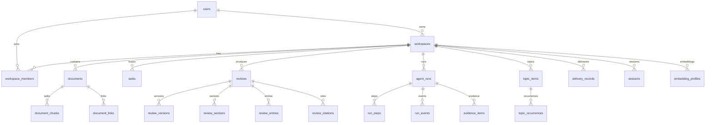

# mylife 数据模型

> 版本：v0.1 ｜ 日期：2026-11-06 ｜ 关联：`ARCHITECTURE.md` v0.4 §5/§6 ｜ 数据库：PostgreSQL 16 + pgvector
>
> 本文件是 Alembic 迁移与约束测试的单一事实源。所有表、列、约束、索引以本文件为准；与架构文档冲突时，先修本文件再修架构。

---

## 1. 约定

| 项 | 约定 |
|---|---|
| 扩展 | `pgcrypto`（`gen_random_uuid`）、`vector`（pgvector）；UUIDv7 由应用生成时优先使用 |
| 主键 | `uuid`；默认 `gen_random_uuid()`；业务表统一 `id` |
| 时间 | 一律 `timestamptz`，UTC；`created_at`/`updated_at` 默认 `now()` |
| 命名 | 表名复数 snake_case；列名 snake_case；索引 `idx_`、唯一 `uq_`、外键 `fk_`、检查 `ck_` |
| 租户 | 所有业务表 `workspace_id uuid NOT NULL`；RLS `ENABLE` + `FORCE` |
| 枚举 | 用 `text + CHECK`，不用 PG enum（便于迁移）；应用层 Pydantic 同步校验 |
| JSON | 灵活字段用 `jsonb`，结构由 `packages/contracts` 冻结；禁止无 schema 的自由 JSON 长期存储 |
| 软删除 | 仅 `deletion_requests` 有状态机；`reviews` 用 `superseded_by`；其余按 Workspace 级联 |
| 字符 | UTF-8；路径/标题做 NFC 规范化后比较 |
| 向量 | 默认 `vector(1024)`（BGE-M3）；换维走 `embedding_profiles` 蓝绿迁移 |
| 角色 | `mylife_app`（应用，NOBYPASSRLS）、`mylife_system`（调度，仅必要列）、`mylife_migrator`（迁移） |

### 1.1 核心枚举

```text
run_kind          chat | daily | weekly | yearly
run_state         created | snapshotting | planning | retrieving | drafting |
                  reviewing | revising | human_gate | delivering | succeeded |
                  retry_wait | needs_human | security_abort | failed | cancelled
                  （chat 精简分支：created | retrieving | drafting | verifying | succeeded | failed | cancelled）
source_type       user | generated
evidence_type     document | chunk | review | task | stats
item_type         error | method | action
topic_status      open | resolved | stale
delivery_status   pending | blocked | committing | pr_open | merged | conflict | failed | noop
deletion_state    requested | cooling | purged | cancelled
embedding_status  active | building | retired
trigger_type      manual | schedule | api | chat
```

---

## 2. ER 图



---

## 3. 基线表

> 来自 REQUIREMENTS §7，已冻结；本文件补充类型与约束。除特别说明外，所有表含 `workspace_id` 并启用 RLS。

### 3.1 users

```sql
CREATE TABLE users (
  id uuid PRIMARY KEY DEFAULT gen_random_uuid(),
  email text NOT NULL,
  password_hash text NOT NULL,              -- Argon2id
  display_name text NOT NULL,
  status text NOT NULL DEFAULT 'active'
    CHECK (status IN ('active','disabled','deleted')),
  created_at timestamptz NOT NULL DEFAULT now(),
  updated_at timestamptz NOT NULL DEFAULT now(),
  UNIQUE (lower(email))
);
```

### 3.2 workspaces

```sql
CREATE TABLE workspaces (
  id uuid PRIMARY KEY DEFAULT gen_random_uuid(),
  name text NOT NULL,
  slug text NOT NULL,
  owner_id uuid NOT NULL REFERENCES users(id) ON DELETE RESTRICT,
  plan text NOT NULL DEFAULT 'free' CHECK (plan IN ('free','pro')),
  created_at timestamptz NOT NULL DEFAULT now(),
  UNIQUE (slug)
);
```

### 3.3 workspace_members

```sql
CREATE TABLE workspace_members (
  workspace_id uuid NOT NULL REFERENCES workspaces(id) ON DELETE CASCADE,
  user_id uuid NOT NULL REFERENCES users(id) ON DELETE CASCADE,
  role text NOT NULL CHECK (role IN ('owner','admin','member')),
  joined_at timestamptz NOT NULL DEFAULT now(),
  PRIMARY KEY (workspace_id, user_id)
);
```

### 3.4 documents

```sql
CREATE TABLE documents (
  id uuid PRIMARY KEY DEFAULT gen_random_uuid(),
  workspace_id uuid NOT NULL REFERENCES workspaces(id) ON DELETE CASCADE,
  path text NOT NULL,                        -- 相对 source vault 根；NFC
  title text NOT NULL,
  content text NOT NULL,
  frontmatter_json jsonb NOT NULL DEFAULT '{}',
  content_hash text NOT NULL,                -- parser_version + body + frontmatter
  size bigint NOT NULL,
  mtime timestamptz,                         -- 仅参考；业务日期用 occurred_on
  indexed_at timestamptz,
  -- 检索扩展
  tags text[] NOT NULL DEFAULT '{}',
  extension text NOT NULL DEFAULT 'md',
  search_text text NOT NULL DEFAULT '',      -- jieba 预分词，空格连接
  tsv tsvector GENERATED ALWAYS AS (to_tsvector('simple', search_text)) STORED,
  occurred_on date,
  source_type text NOT NULL DEFAULT 'user' CHECK (source_type IN ('user','generated')),
  UNIQUE (workspace_id, path)
);
```

### 3.5 document_chunks

```sql
CREATE TABLE document_chunks (
  id uuid PRIMARY KEY DEFAULT gen_random_uuid(),
  workspace_id uuid NOT NULL REFERENCES workspaces(id) ON DELETE CASCADE,
  document_id uuid NOT NULL REFERENCES documents(id) ON DELETE CASCADE,
  heading text,
  content text NOT NULL,
  token_count int NOT NULL,
  chunk_ordinal int NOT NULL,
  chunk_hash text NOT NULL,
  embedding vector(1024),                    -- 维度随 embedding_profile；迁移见 §7
  UNIQUE (document_id, chunk_ordinal)
);
```

### 3.6 document_links

```sql
CREATE TABLE document_links (
  id uuid PRIMARY KEY DEFAULT gen_random_uuid(),
  workspace_id uuid NOT NULL REFERENCES workspaces(id) ON DELETE CASCADE,
  source_document_id uuid NOT NULL REFERENCES documents(id) ON DELETE CASCADE,
  target_path text NOT NULL,
  link_text text,
  UNIQUE (source_document_id, target_path, link_text)
);
```

### 3.7 tasks

```sql
CREATE TABLE tasks (
  id uuid PRIMARY KEY DEFAULT gen_random_uuid(),
  workspace_id uuid NOT NULL REFERENCES workspaces(id) ON DELETE CASCADE,
  key text NOT NULL,                         -- 归一化任务文本的 canonical_key
  text text NOT NULL,
  status text NOT NULL DEFAULT 'open'
    CHECK (status IN ('open','done','carried','dropped')),
  first_seen date NOT NULL,
  last_seen date NOT NULL,
  done_date date,
  source_path text,
  line_number int,
  UNIQUE (workspace_id, key)
);
```

### 3.8 reviews

```sql
CREATE TABLE reviews (
  id uuid PRIMARY KEY DEFAULT gen_random_uuid(),
  workspace_id uuid NOT NULL REFERENCES workspaces(id) ON DELETE CASCADE,
  kind text NOT NULL CHECK (kind IN ('daily','weekly','yearly')),
  period_key text NOT NULL,
  title text NOT NULL,
  content text NOT NULL,                     -- 当前 version 的 Markdown
  model text,
  generated_at timestamptz NOT NULL DEFAULT now(),
  version int NOT NULL DEFAULT 1,
  content_hash text,
  git_path text,
  status text NOT NULL DEFAULT 'draft'
    CHECK (status IN ('draft','in_review','published','superseded','manual')),
  superseded_by uuid REFERENCES reviews(id),
  UNIQUE (workspace_id, kind, period_key, version)
);
```

### 3.9 conversations

```sql
CREATE TABLE conversations (
  id uuid PRIMARY KEY DEFAULT gen_random_uuid(),
  workspace_id uuid NOT NULL REFERENCES workspaces(id) ON DELETE CASCADE,
  user_id uuid NOT NULL REFERENCES users(id) ON DELETE CASCADE,
  title text NOT NULL DEFAULT '新对话',
  created_at timestamptz NOT NULL DEFAULT now(),
  updated_at timestamptz NOT NULL DEFAULT now()
);
```

### 3.10 messages

```sql
CREATE TABLE messages (
  id uuid PRIMARY KEY DEFAULT gen_random_uuid(),
  workspace_id uuid NOT NULL REFERENCES workspaces(id) ON DELETE CASCADE,
  conversation_id uuid NOT NULL REFERENCES conversations(id) ON DELETE CASCADE,
  run_id uuid,                               -- 关联 agent_runs
  role text NOT NULL CHECK (role IN ('user','assistant','system','tool')),
  content text NOT NULL,
  references_json jsonb NOT NULL DEFAULT '[]',
  tool_events_json jsonb NOT NULL DEFAULT '[]',
  status text NOT NULL DEFAULT 'complete'
    CHECK (status IN ('drafting','complete','partial','cancelled')),
  created_at timestamptz NOT NULL DEFAULT now(),
  UNIQUE (conversation_id, created_at, id)
);
```

### 3.11 usage_events

```sql
CREATE TABLE usage_events (
  id uuid PRIMARY KEY DEFAULT gen_random_uuid(),
  workspace_id uuid NOT NULL REFERENCES workspaces(id) ON DELETE CASCADE,
  user_id uuid,
  kind text NOT NULL,                        -- chat | review | tool | embedding
  model text,
  prompt_tokens int NOT NULL DEFAULT 0,
  completion_tokens int NOT NULL DEFAULT 0,
  latency_ms int,                            -- FR-D8 耗时
  cost numeric(12,6) NOT NULL DEFAULT 0,
  degraded boolean NOT NULL DEFAULT false,
  created_at timestamptz NOT NULL DEFAULT now()
);
```

### 3.12 audit_logs

```sql
CREATE TABLE audit_logs (
  id uuid PRIMARY KEY DEFAULT gen_random_uuid(),
  workspace_id uuid,
  user_id uuid,
  action text NOT NULL,                      -- login/import/delete/config/review...
  target text,
  detail jsonb NOT NULL DEFAULT '{}',
  ip inet,
  created_at timestamptz NOT NULL DEFAULT now()
);
```

### 3.13 invite_codes

```sql
CREATE TABLE invite_codes (
  id uuid PRIMARY KEY DEFAULT gen_random_uuid(),
  code text NOT NULL,
  created_by uuid NOT NULL REFERENCES users(id),
  used_by uuid REFERENCES users(id),
  expires_at timestamptz,
  used_at timestamptz,
  UNIQUE (code)
);
```

### 3.14 job_runs

```sql
CREATE TABLE job_runs (
  id uuid PRIMARY KEY DEFAULT gen_random_uuid(),
  workspace_id uuid NOT NULL REFERENCES workspaces(id) ON DELETE CASCADE,
  kind text NOT NULL,                        -- ingest/embed/review/delivery/export
  period_key text,
  status text NOT NULL
    CHECK (status IN ('queued','running','succeeded','failed','skipped','cancelled')),
  error text,
  run_key text,
  state text,
  agent_run_id uuid,
  started_at timestamptz,
  finished_at timestamptz
);
```

---

## 4. 增量表

### 4.1 agent_runs

```sql
CREATE TABLE agent_runs (
  id uuid PRIMARY KEY DEFAULT gen_random_uuid(),
  workspace_id uuid NOT NULL REFERENCES workspaces(id) ON DELETE CASCADE,
  kind text NOT NULL CHECK (kind IN ('chat','daily','weekly','yearly')),
  period_key text,
  conversation_id uuid REFERENCES conversations(id) ON DELETE CASCADE,
  client_turn_id uuid,
  state text NOT NULL,
  state_payload jsonb NOT NULL DEFAULT '{}',
  attempt_id uuid,
  idem_key text NOT NULL,
  lease_owner text,
  lease_expires_at timestamptz,
  retry_from_state text,
  snapshot_id uuid,
  version int,
  supersedes_run_id uuid REFERENCES agent_runs(id),
  trace_id text,
  created_at timestamptz NOT NULL DEFAULT now(),
  updated_at timestamptz NOT NULL DEFAULT now(),
  CHECK (kind <> 'chat' OR period_key IS NULL),
  CHECK (kind = 'chat' OR period_key IS NOT NULL),
  CHECK (kind <> 'chat' OR conversation_id IS NOT NULL),
  UNIQUE (workspace_id, idem_key)
);
```

### 4.2 run_steps

```sql
CREATE TABLE run_steps (
  id uuid PRIMARY KEY DEFAULT gen_random_uuid(),
  workspace_id uuid NOT NULL REFERENCES workspaces(id) ON DELETE CASCADE,
  run_id uuid NOT NULL REFERENCES agent_runs(id) ON DELETE CASCADE,
  seq int NOT NULL,
  role text NOT NULL CHECK (role IN ('planner','worker','writer','reviewer','system')),
  tool_name text,
  status text NOT NULL CHECK (status IN ('started','succeeded','failed','skipped')),
  input_digest text,
  output_digest text,
  model text,
  tokens_in int NOT NULL DEFAULT 0,
  tokens_out int NOT NULL DEFAULT 0,
  latency_ms int,
  created_at timestamptz NOT NULL DEFAULT now(),
  UNIQUE (run_id, seq)
);
```

### 4.3 run_events

```sql
CREATE TABLE run_events (
  event_id bigserial PRIMARY KEY,            -- 全局单调，SSE cursor
  workspace_id uuid NOT NULL REFERENCES workspaces(id) ON DELETE CASCADE,
  run_id uuid NOT NULL REFERENCES agent_runs(id) ON DELETE CASCADE,
  from_state text,
  to_state text,
  event text NOT NULL,
  payload jsonb NOT NULL DEFAULT '{}',
  created_at timestamptz NOT NULL DEFAULT now()
);
```

### 4.4 source_snapshots

```sql
CREATE TABLE source_snapshots (
  id uuid PRIMARY KEY DEFAULT gen_random_uuid(),
  workspace_id uuid NOT NULL REFERENCES workspaces(id) ON DELETE CASCADE,
  commit_sha text,
  manifest_digest text NOT NULL,
  doc_count int NOT NULL,
  as_of timestamptz NOT NULL,
  created_at timestamptz NOT NULL DEFAULT now(),
  UNIQUE (workspace_id, commit_sha)
);
```

### 4.5 snapshot_documents

```sql
CREATE TABLE snapshot_documents (
  id uuid PRIMARY KEY DEFAULT gen_random_uuid(),
  workspace_id uuid NOT NULL REFERENCES workspaces(id) ON DELETE CASCADE,
  snapshot_id uuid NOT NULL REFERENCES source_snapshots(id) ON DELETE CASCADE,
  document_id uuid NOT NULL,
  path text NOT NULL,
  content_hash text NOT NULL,
  UNIQUE (snapshot_id, document_id)
);
```

### 4.6 document_changes

```sql
CREATE TABLE document_changes (
  id uuid PRIMARY KEY DEFAULT gen_random_uuid(),
  workspace_id uuid NOT NULL REFERENCES workspaces(id) ON DELETE CASCADE,
  document_id uuid NOT NULL,
  change_type text NOT NULL CHECK (change_type IN ('added','modified','deleted','renamed')),
  source_date date,
  commit_sha text,
  created_at timestamptz NOT NULL DEFAULT now()
);
```

### 4.7 task_occurrences

```sql
CREATE TABLE task_occurrences (
  id uuid PRIMARY KEY DEFAULT gen_random_uuid(),
  workspace_id uuid NOT NULL REFERENCES workspaces(id) ON DELETE CASCADE,
  task_id uuid NOT NULL REFERENCES tasks(id) ON DELETE CASCADE,
  document_id uuid NOT NULL,
  occurrence_date date NOT NULL,
  checked boolean NOT NULL,
  line_number int NOT NULL,
  raw_text text NOT NULL,
  UNIQUE (workspace_id, document_id, occurrence_date, line_number)
);
```

### 4.8 evidence_items

```sql
CREATE TABLE evidence_items (
  id uuid PRIMARY KEY DEFAULT gen_random_uuid(),
  workspace_id uuid NOT NULL REFERENCES workspaces(id) ON DELETE CASCADE,
  run_id uuid NOT NULL REFERENCES agent_runs(id) ON DELETE CASCADE,
  evidence_id text NOT NULL,
  snapshot_id uuid NOT NULL REFERENCES source_snapshots(id),
  source_type text NOT NULL
    CHECK (source_type IN ('document','chunk','review','task','stats')),
  document_id uuid,
  chunk_id uuid,
  source_path text,
  source_date date,
  occurred_on date,
  document_content_hash text,                -- stats 用规范统计载荷哈希
  heading text,
  tags text[] NOT NULL DEFAULT '{}',
  line_start int,
  line_end int,
  quote text NOT NULL,
  quote_hash text NOT NULL,
  created_at timestamptz NOT NULL DEFAULT now(),
  CHECK (source_type <> 'stats' OR source_path IS NULL),
  CHECK (source_type NOT IN ('document','chunk','review') OR document_content_hash IS NOT NULL),
  UNIQUE (run_id, evidence_id)
);
```

### 4.9 review_sections

```sql
CREATE TABLE review_sections (
  id uuid PRIMARY KEY DEFAULT gen_random_uuid(),
  workspace_id uuid NOT NULL REFERENCES workspaces(id) ON DELETE CASCADE,
  review_id uuid NOT NULL REFERENCES reviews(id) ON DELETE CASCADE,
  version int NOT NULL,
  section_key text NOT NULL,
  ordinal int NOT NULL,
  content_md text NOT NULL,
  structured_json jsonb NOT NULL DEFAULT '{}',
  created_at timestamptz NOT NULL DEFAULT now(),
  UNIQUE (review_id, version, section_key),
  UNIQUE (review_id, version, ordinal)
);
```

### 4.10 review_entries

```sql
CREATE TABLE review_entries (
  id uuid PRIMARY KEY DEFAULT gen_random_uuid(),
  workspace_id uuid NOT NULL REFERENCES workspaces(id) ON DELETE CASCADE,
  review_id uuid NOT NULL REFERENCES reviews(id) ON DELETE CASCADE,
  version int NOT NULL,
  section_key text NOT NULL,
  item_type text NOT NULL CHECK (item_type IN ('error','method','action')),
  canonical_key text NOT NULL,
  fields_json jsonb NOT NULL,
  source_path text,
  line_start int,
  line_end int,
  evidence_id text,
  source_date date,
  confidence numeric(3,2),
  created_at timestamptz NOT NULL DEFAULT now(),
  UNIQUE (review_id, version, section_key, item_type, canonical_key)
);
```

### 4.11 review_citations

```sql
CREATE TABLE review_citations (
  id uuid PRIMARY KEY DEFAULT gen_random_uuid(),
  workspace_id uuid NOT NULL REFERENCES workspaces(id) ON DELETE CASCADE,
  review_id uuid NOT NULL REFERENCES reviews(id) ON DELETE CASCADE,
  version int NOT NULL,
  claim_id text NOT NULL,
  evidence_id text NOT NULL,
  source_path text,
  source_date date,
  document_content_hash text,
  line_start int,
  line_end int,
  quote text NOT NULL,
  quote_hash text NOT NULL,
  UNIQUE (review_id, version, claim_id, evidence_id)
);
```

### 4.12 review_versions

```sql
CREATE TABLE review_versions (
  id uuid PRIMARY KEY DEFAULT gen_random_uuid(),
  workspace_id uuid NOT NULL REFERENCES workspaces(id) ON DELETE CASCADE,
  review_id uuid NOT NULL REFERENCES reviews(id) ON DELETE CASCADE,
  version int NOT NULL,
  content_md text NOT NULL,
  content_hash text NOT NULL,
  git_sha text,
  model text,
  prompt_version text,
  snapshot_id uuid REFERENCES source_snapshots(id),
  created_at timestamptz NOT NULL DEFAULT now(),
  UNIQUE (review_id, version)
);
```

### 4.13 review_search

```sql
CREATE TABLE review_search (
  id uuid PRIMARY KEY DEFAULT gen_random_uuid(),
  workspace_id uuid NOT NULL REFERENCES workspaces(id) ON DELETE CASCADE,
  review_id uuid NOT NULL REFERENCES reviews(id) ON DELETE CASCADE,
  version int NOT NULL,
  kind text NOT NULL,
  period_key text NOT NULL,
  title text NOT NULL,
  path text NOT NULL,
  search_text text NOT NULL DEFAULT '',
  tsv tsvector GENERATED ALWAYS AS (to_tsvector('simple', search_text)) STORED,
  occurred_on date,
  content_hash text NOT NULL,
  is_current boolean NOT NULL DEFAULT true,
  UNIQUE (review_id, version)
);
```

### 4.14 topic_items

```sql
CREATE TABLE topic_items (
  id uuid PRIMARY KEY DEFAULT gen_random_uuid(),
  workspace_id uuid NOT NULL REFERENCES workspaces(id) ON DELETE CASCADE,
  topic text NOT NULL CHECK (topic IN ('errors','methods','actions')),
  canonical_key text NOT NULL,
  title text NOT NULL,
  first_seen date NOT NULL,
  last_seen date NOT NULL,
  occurrence_count int NOT NULL DEFAULT 0,
  status text NOT NULL DEFAULT 'pending'
    CHECK (status IN ('pending','open','resolved','stale')),
  created_at timestamptz NOT NULL DEFAULT now(),
  UNIQUE (workspace_id, topic, canonical_key)
);
```

### 4.15 topic_occurrences

```sql
CREATE TABLE topic_occurrences (
  id uuid PRIMARY KEY DEFAULT gen_random_uuid(),
  workspace_id uuid NOT NULL REFERENCES workspaces(id) ON DELETE CASCADE,
  item_id uuid NOT NULL REFERENCES topic_items(id) ON DELETE CASCADE,
  source_date date NOT NULL,
  source_path text NOT NULL,
  line_start int,
  line_end int,
  quote text NOT NULL,
  evidence_id text,
  UNIQUE (item_id, source_date, source_path, line_start)
);
```

### 4.16 delivery_records

```sql
CREATE TABLE delivery_records (
  id uuid PRIMARY KEY DEFAULT gen_random_uuid(),
  workspace_id uuid NOT NULL REFERENCES workspaces(id) ON DELETE CASCADE,
  review_id uuid NOT NULL REFERENCES reviews(id) ON DELETE CASCADE,
  version int NOT NULL,
  target text NOT NULL CHECK (target IN ('git','object_store','db_only')),
  provider text,
  branch text,
  commit_sha text,
  pr_number int,
  status text NOT NULL
    CHECK (status IN ('pending','blocked','committing','pr_open','merged','conflict','failed','noop')),
  merged_commit text,
  created_at timestamptz NOT NULL DEFAULT now(),
  updated_at timestamptz NOT NULL DEFAULT now(),
  UNIQUE (workspace_id, review_id, version, target)
);
```

### 4.17 delivery_events

```sql
CREATE TABLE delivery_events (
  id uuid PRIMARY KEY DEFAULT gen_random_uuid(),
  workspace_id uuid NOT NULL REFERENCES workspaces(id) ON DELETE CASCADE,
  provider_delivery_id text NOT NULL,
  conn_id uuid REFERENCES git_connections(id),
  event text NOT NULL,
  payload_digest text NOT NULL,
  created_at timestamptz NOT NULL DEFAULT now(),
  UNIQUE (provider_delivery_id)
);
```

### 4.18 workspace_schedules

```sql
CREATE TABLE workspace_schedules (
  id uuid PRIMARY KEY DEFAULT gen_random_uuid(),
  workspace_id uuid NOT NULL REFERENCES workspaces(id) ON DELETE CASCADE,
  kind text NOT NULL CHECK (kind IN ('daily','weekly','yearly')),
  local_time time NOT NULL,
  timezone text NOT NULL,
  next_run_at timestamptz,
  catchup_days int NOT NULL DEFAULT 7 CHECK (catchup_days BETWEEN 0 AND 30),
  enabled boolean NOT NULL DEFAULT true,
  last_skip_reason text
    CHECK (last_skip_reason IN ('catchup_window_exceeded','period_already_succeeded',NULL)),
  UNIQUE (workspace_id, kind)
);
```

### 4.19 git_connections

```sql
CREATE TABLE git_connections (
  id uuid PRIMARY KEY DEFAULT gen_random_uuid(),
  workspace_id uuid NOT NULL REFERENCES workspaces(id) ON DELETE CASCADE,
  role text NOT NULL CHECK (role IN ('source','output')),
  provider text NOT NULL CHECK (provider IN ('github','gitlab','generic')),
  repo_full_name text NOT NULL,
  base_branch text NOT NULL DEFAULT 'main',
  auth_type text NOT NULL CHECK (auth_type IN ('github_app','deploy_key','pat')),
  credential_ciphertext bytea,
  credential_key_version int,
  reviews_root text,
  mode text CHECK (mode IN ('managed','vault_writeback','separate')),
  sync_enabled boolean NOT NULL DEFAULT false,
  sync_interval_minutes int NOT NULL DEFAULT 0 CHECK (sync_interval_minutes >= 0),
  next_sync_at timestamptz,
  last_sync_at timestamptz,
  last_sync_status text CHECK (last_sync_status IN ('ok','failed','skipped')),
  created_at timestamptz NOT NULL DEFAULT now(),
  updated_at timestamptz NOT NULL DEFAULT now(),
  UNIQUE (workspace_id, provider, repo_full_name, role)
);
```

### 4.20 workspace_settings

```sql
CREATE TABLE workspace_settings (
  workspace_id uuid PRIMARY KEY REFERENCES workspaces(id) ON DELETE CASCADE,
  timezone text NOT NULL DEFAULT 'Asia/Shanghai',
  daily_at time NOT NULL DEFAULT '01:00',
  weekly_at time NOT NULL DEFAULT '01:30',
  yearly_at time NOT NULL DEFAULT '02:00',
  reviews_root text NOT NULL DEFAULT 'wiki/复盘',
  delivery_policy_json jsonb NOT NULL DEFAULT '{}',
  auto_merge_daily boolean NOT NULL DEFAULT false,
  retrieval_top_k int NOT NULL DEFAULT 20 CHECK (retrieval_top_k BETWEEN 1 AND 50),
  context_window_tokens int NOT NULL DEFAULT 32000 CHECK (context_window_tokens BETWEEN 4000 AND 200000),
  web_search_enabled boolean NOT NULL DEFAULT false,
  embedding_profile_id uuid,
  updated_at timestamptz NOT NULL DEFAULT now()
);
```

### 4.21 sessions

```sql
CREATE TABLE sessions (
  id uuid PRIMARY KEY DEFAULT gen_random_uuid(),
  user_id uuid NOT NULL REFERENCES users(id) ON DELETE CASCADE,
  token_hash text NOT NULL,
  token_version int NOT NULL DEFAULT 1,
  active_workspace_id uuid REFERENCES workspaces(id),
  expires_at timestamptz NOT NULL,
  revoked_at timestamptz,
  created_at timestamptz NOT NULL DEFAULT now(),
  UNIQUE (token_hash)
);
```

### 4.22 provider_credentials

```sql
CREATE TABLE provider_credentials (
  id uuid PRIMARY KEY DEFAULT gen_random_uuid(),
  workspace_id uuid NOT NULL REFERENCES workspaces(id) ON DELETE CASCADE,
  provider text NOT NULL CHECK (provider IN ('llm','embedding')),
  key_ciphertext bytea NOT NULL,
  key_version int NOT NULL,
  status text NOT NULL DEFAULT 'active' CHECK (status IN ('active','invalid','disabled')),
  last_tested_at timestamptz,
  created_at timestamptz NOT NULL DEFAULT now(),
  updated_at timestamptz NOT NULL DEFAULT now(),
  UNIQUE (workspace_id, provider)
);
```

### 4.23 embedding_profiles

```sql
CREATE TABLE embedding_profiles (
  id uuid PRIMARY KEY DEFAULT gen_random_uuid(),
  workspace_id uuid NOT NULL REFERENCES workspaces(id) ON DELETE CASCADE,
  provider text NOT NULL,
  model text NOT NULL,
  dimension int NOT NULL CHECK (dimension > 0),
  index_name text NOT NULL,
  status text NOT NULL DEFAULT 'building'
    CHECK (status IN ('active','building','retired')),
  created_at timestamptz NOT NULL DEFAULT now(),
  UNIQUE (workspace_id, model, dimension)
);
```

### 4.24 export_jobs

```sql
CREATE TABLE export_jobs (
  id uuid PRIMARY KEY DEFAULT gen_random_uuid(),
  workspace_id uuid NOT NULL REFERENCES workspaces(id) ON DELETE CASCADE,
  requested_by uuid NOT NULL REFERENCES users(id),
  status text NOT NULL DEFAULT 'queued'
    CHECK (status IN ('queued','running','succeeded','failed','expired')),
  artifact_key text,
  expires_at timestamptz,
  error text,
  created_at timestamptz NOT NULL DEFAULT now()
);
```

### 4.25 deletion_requests

```sql
CREATE TABLE deletion_requests (
  id uuid PRIMARY KEY DEFAULT gen_random_uuid(),
  workspace_id uuid NOT NULL REFERENCES workspaces(id) ON DELETE CASCADE,
  scope text NOT NULL CHECK (scope IN ('account','workspace')),
  state text NOT NULL DEFAULT 'requested'
    CHECK (state IN ('requested','cooling','purged','cancelled')),
  purge_at timestamptz NOT NULL,
  requested_by uuid NOT NULL REFERENCES users(id),
  cancelled_at timestamptz,
  created_at timestamptz NOT NULL DEFAULT now()
);
```

### 4.26 document_chunks 扩展

```sql
ALTER TABLE document_chunks
  ADD COLUMN embedding_profile_id uuid REFERENCES embedding_profiles(id),
  ADD CONSTRAINT ck_chunk_profile
    CHECK (embedding IS NULL OR embedding_profile_id IS NOT NULL);
```

蓝绿换维时，新表命名为 `document_chunks_v{n}`，列结构与本表一致，仅 `embedding` 维度不同；切换完成后旧表延迟删除。

---

## 5. 索引

```sql
-- agent_runs：三把部分唯一索引
CREATE UNIQUE INDEX uq_runs_review_active
  ON agent_runs (workspace_id, kind, period_key)
  WHERE kind IN ('daily','weekly','yearly')
    AND state IN ('created','snapshotting','planning','retrieving','drafting',
                  'reviewing','revising','human_gate','delivering',
                  'retry_wait','needs_human');

CREATE UNIQUE INDEX uq_runs_chat_serial
  ON agent_runs (workspace_id, conversation_id)
  WHERE kind = 'chat'
    AND state IN ('created','retrieving','drafting','verifying');

CREATE UNIQUE INDEX uq_runs_chat_turn
  ON agent_runs (workspace_id, conversation_id, client_turn_id)
  WHERE kind = 'chat';

-- 文档检索
CREATE INDEX idx_documents_tsv        ON documents USING gin (tsv);
CREATE INDEX idx_documents_tags       ON documents USING gin (tags);
CREATE INDEX idx_documents_occurred   ON documents (workspace_id, occurred_on);
CREATE INDEX idx_documents_extension  ON documents (workspace_id, extension);
CREATE INDEX idx_documents_path       ON documents (path text_pattern_ops);
CREATE INDEX idx_chunks_embedding     ON document_chunks
  USING hnsw (embedding vector_cosine_ops) WITH (m = 16, ef_construction = 64);

-- 复盘检索（只索引 current version）
CREATE UNIQUE INDEX uq_review_search_current
  ON review_search (workspace_id, kind, period_key)
  WHERE is_current;
CREATE INDEX idx_review_search_tsv    ON review_search USING gin (tsv);
CREATE INDEX idx_review_search_date   ON review_search (workspace_id, occurred_on);

-- 复盘条目 / 版本
CREATE INDEX idx_review_entries_key   ON review_entries (workspace_id, item_type, canonical_key);
CREATE INDEX idx_review_entries_ver   ON review_entries (review_id, version);
CREATE INDEX idx_review_citations_ver ON review_citations (review_id, version);
CREATE INDEX idx_review_versions_ver  ON review_versions (review_id, version);

-- 运行 / 事件
CREATE INDEX idx_run_steps_run        ON run_steps (run_id, seq);
CREATE INDEX idx_run_events_run       ON run_events (run_id, event_id);
CREATE INDEX idx_run_events_ws        ON run_events (workspace_id, created_at);

-- 快照 / 变更 / 任务
CREATE INDEX idx_snapshot_docs_snap   ON snapshot_documents (snapshot_id);
CREATE INDEX idx_doc_changes_date     ON document_changes (workspace_id, source_date);
CREATE INDEX idx_task_occ_task        ON task_occurrences (task_id, occurrence_date);
CREATE INDEX idx_tasks_status         ON tasks (workspace_id, status, first_seen);

-- 专题 / 交付
CREATE INDEX idx_topic_items_status   ON topic_items (workspace_id, topic, status);
CREATE INDEX idx_topic_occ_item       ON topic_occurrences (item_id, source_date);
CREATE INDEX idx_delivery_open        ON delivery_records (workspace_id, status)
  WHERE status IN ('pending','committing','pr_open','conflict');
CREATE INDEX idx_delivery_events_conn ON delivery_events (conn_id, created_at);

-- 设置 / 调度 / 会话
CREATE UNIQUE INDEX uq_embedding_active
  ON embedding_profiles (workspace_id) WHERE status = 'active';
CREATE INDEX idx_schedules_next       ON workspace_schedules (next_run_at) WHERE enabled;
CREATE INDEX idx_git_sync_next        ON git_connections (next_sync_at)
  WHERE sync_enabled AND role = 'source';
CREATE INDEX idx_sessions_user        ON sessions (user_id, expires_at);
```

---

## 6. RLS 与租户隔离

### 6.1 角色

```sql
CREATE ROLE mylife_migrator LOGIN;          -- 迁移用，BYPASSRLS 仅迁移窗口
CREATE ROLE mylife_app LOGIN NOINHERIT;     -- 应用；NOBYPASSRLS
CREATE ROLE mylife_system LOGIN NOINHERIT;  -- 调度/sweeper；仅必要列
```

### 6.2 辅助函数

```sql
CREATE OR REPLACE FUNCTION app_workspace_id() RETURNS uuid
LANGUAGE sql STABLE AS $$
  SELECT NULLIF(current_setting('app.workspace_id', true), '')::uuid
$$;
```

### 6.3 通用策略

对每一张含 `workspace_id` 的表执行：

```sql
ALTER TABLE <table> ENABLE ROW LEVEL SECURITY;
ALTER TABLE <table> FORCE ROW LEVEL SECURITY;
CREATE POLICY p_<table>_tenant ON <table>
  USING (workspace_id = app_workspace_id())
  WITH CHECK (workspace_id = app_workspace_id());
```

**无值默认拒绝**：`app.workspace_id` 未设置时，`app_workspace_id()` 返回 NULL，`workspace_id = NULL` 不成立，查询返回 0 行。

### 6.4 特殊表

| 表 | 策略 |
|---|---|
| `workspaces` | `USING (id = app_workspace_id())` |
| `workspace_members` | `USING (workspace_id = app_workspace_id())`；成员列表另由应用层校验 |
| `users` | 无 workspace_id；仅通过 `workspace_members` 关联读取；平台管理员走独立受限查询 |
| `invite_codes` | 平台级；仅 `platform_admin` 与注册事务可访问 |
| `audit_logs` | `workspace_id IS NULL` 的平台审计仅 `platform_admin`；租户审计按 workspace |
| `provider_credentials` | 应用角色只可读 `status/last_tested_at`，密文列由 `mylife_system` 解密 |

### 6.5 系统角色

- `mylife_system` 只允许：调度表读写、`agent_runs` 的租约列、`deletion_requests` 的 purge 状态。
- 禁止给 `mylife_system` 全库 `BYPASSRLS`；按 workspace 循环处理，或使用只暴露必要列的视图。
- 跨租户命中 = `SECURITY_ABORT`，应用层记录 `audit_logs`，不可人工放行。

---

## 7. 版本、幂等与哈希

### 7.1 版本隔离

- `review_sections` / `review_entries` / `review_citations` / `review_versions` 以 `(review_id, version)` 分区。
- 写入只追加新 version，不覆盖旧行。
- 所有跨版本聚合必须限定 `version = reviews.version` 或 `reviews.superseded_by IS NULL`。
- `review_search` 只保留 current version：新版本写入时同事务把旧行 `is_current=false`，新行 `is_current=true`。
- 回滚按 version 指针：恢复目标 `review_versions.content_md`，把 `reviews.version` 指向该版本，子表按该 version 读取。

### 7.2 幂等键

| 对象 | 键 |
|---|---|
| 复盘 run | `(workspace_id, kind, period_key)` 活跃唯一 |
| chat run | `(workspace_id, conversation_id, client_turn_id)` |
| 导入 | `(workspace_id, document_id, content_hash)` |
| 证据 | `(run_id, evidence_id)` |
| 交付 | `(workspace_id, review_id, version, target)` |
| webhook | `provider_delivery_id` |
| 专题 | `(workspace_id, topic, canonical_key)` |

### 7.3 哈希算法

```text
content_hash       = sha256(parser_version + "\x1f" + normalized_body + "\x1f" + canonical_frontmatter)
quote_hash         = sha256(parser_version + "\x1f" + normalize(quote))
canonical_key      = sha256(item_type + "\x1f" + normalize(title | root_cause))
root_cause_fingerprint = sha256(normalize(root_cause))
```

`normalize`：NFC、去首尾空白、连续空白折叠为一个空格、中文标点统一、英文小写（仅用于 key，不改变展示文本）。

---

## 8. 迁移策略

1. **Alembic**：所有 DDL 通过迁移；禁止手工改生产库。
2. **expand-contract**：先加可空列/新表 → 双写/回填 → 校验 → 切读 → 删旧列；每步可回滚。
3. **schema_version**：`alembic_version` + 应用侧 `schema_version` 常量；不匹配时拒绝启动。
4. **蓝绿换维**：
   - 新建 `embedding_profiles` 行（status=building）；
   - 新建 `document_chunks_v{n}` 与 HNSW 索引；
   - 全量 re-embed；
   - 校验覆盖率与抽样一致性；
   - 事务内切换 `workspace_settings.embedding_profile_id`，旧 profile 置 retired；
   - 旧表延迟 7 天删除。
5. **回滚**：保留上一 profile 与旧表；切换失败回滚指针，不删数据。

---

## 9. 保留与删除

### 9.1 删除状态机

```text
requested → cooling（30 天）→ purged
        └→ cancelled
```

- `purge_at = requested_at + 30 days`。
- 冷却期内可取消；到期由 dispatcher/sweeper 执行 purge。
- 删除前必须提供导出 ZIP（`export_jobs`）。

### 9.2 purge 级联清单

必须清除含正文/引用/向量的数据：

```text
documents, document_chunks, document_links, tasks, task_occurrences
reviews, review_versions, review_sections, review_entries, review_citations, review_search
topic_items, topic_occurrences
conversations, messages
agent_runs, run_steps, run_events, evidence_items
source_snapshots, snapshot_documents, document_changes
delivery_records, delivery_events
provider_credentials, embedding_profiles, export_jobs, workspace_settings
sessions, workspace_members
MinIO objects, Redis keys, vector tables
```

- `audit_logs` 保留脱敏元数据（action、target、时间、actor），不保留正文。
- Git 历史保留（决策 7A/补充决策 11）；**正向断言已合并提交可通过 git log 读取**；用户须知“不承诺从 Git 历史抹除”。
- 删除后任何只读端点不得返回正文；验收断言 `SELECT count(*) = 0` 对上述表成立。

---

## 10. 关键查询

### 10.1 混合检索（RRF k=60）

```sql
WITH lex AS (
  SELECT chunk_id, rank() OVER (ORDER BY ts_rank_cd(tsv, q) DESC) AS r
  FROM documents d
  JOIN document_chunks c ON c.document_id = d.id
  CROSS JOIN to_tsquery('simple', :tsquery) q
  WHERE d.workspace_id = app_workspace_id()
    AND d.tsv @@ q
  ORDER BY ts_rank_cd(d.tsv, q) DESC
  LIMIT 50
),
vec AS (
  SELECT chunk_id, rank() OVER (ORDER BY embedding <=> :qvec) AS r
  FROM document_chunks
  WHERE workspace_id = app_workspace_id()
  ORDER BY embedding <=> :qvec
  LIMIT 50
)
SELECT chunk_id, sum(1.0 / (60 + r)) AS score
FROM (SELECT * FROM lex UNION ALL SELECT * FROM vec) s
GROUP BY chunk_id
ORDER BY score DESC
LIMIT :top_k;
```

### 10.2 任务顺延

```sql
SELECT t.*
FROM tasks t
WHERE t.workspace_id = app_workspace_id()
  AND t.status = 'open'
  AND t.first_seen < :period_start
ORDER BY t.first_seen;
```

### 10.3 重复错误

```sql
SELECT canonical_key, count(*) AS occurrences
FROM review_entries e
JOIN reviews r ON r.id = e.review_id
WHERE e.workspace_id = app_workspace_id()
  AND e.item_type = 'error'
  AND e.version = r.version
  AND r.superseded_by IS NULL
GROUP BY canonical_key
HAVING count(*) >= 2;
```

### 10.4 周/年 rollup

```sql
SELECT section_key, structured_json
FROM review_sections s
JOIN reviews r ON r.id = s.review_id
WHERE r.workspace_id = app_workspace_id()
  AND r.kind = 'daily'
  AND r.period_key BETWEEN :start AND :end
  AND s.version = r.version
  AND r.superseded_by IS NULL;
```

### 10.5 open PR

```sql
SELECT *
FROM delivery_records
WHERE workspace_id = app_workspace_id()
  AND status IN ('pending','committing','pr_open','conflict');
```

---

## 11. 验收测试

| # | 测试 | 预期 |
|---|---|---|
| DM01 | 未设置 `app.workspace_id` 查询任意租户表 | 0 行 |
| DM02 | A 会话查 B 的 documents | 0 行 |
| DM03 | A 会话写 B 的 documents | 拒绝 |
| DM04 | 同 `(ws,kind,period)` 建第二个活跃 run | 唯一索引冲突 |
| DM05 | 不同 conversation 的 chat run 并发 | 均成功 |
| DM06 | 同 `(conversation, client_turn_id)` 重试 | 唯一索引冲突/幂等返回 |
| DM07 | 同 period 重跑 | 同路径、version+1、无重复文件 |
| DM08 | review_entries 跨 version 聚合 | 只读 current version |
| DM09 | 统计证据（stats）插入 | `source_path` 为 NULL 允许，hash 非空 |
| DM10 | document 证据缺 `document_content_hash` | CHECK 拒绝 |
| DM11 | `topic_items.status='pending'` | 允许，但不进专题页与 open 视图 |
| DM12 | `embedding_profiles` 同 ws 两个 active | 部分唯一索引拒绝 |
| DM13 | `review_search` 同 ws/kind/period 两个 current | 部分唯一索引拒绝 |
| DM14 | 删除 Workspace | 所有含正文表 0 行；audit_logs 脱敏保留 |
| DM15 | Git 历史 | 删除后仍可读（7A），用户告知可见 |
| DM16 | 搜索 10k 文档 | P95 < 1s（结合 AC） |
| DM17 | 200MB ZIP 导入 | < 10min（结合 AC） |
| DM18 | 租约过期 | sweeper 回收，run 可续跑 |
| DM19 | webhook 重放 | `provider_delivery_id` 唯一，幂等 |
| DM20 | `git_connections` 同 ws 同 repo 的 source/output | 允许两条（role 区分） |
| DM21 | 删除后访问 `/reviews/{id}` | 404 |
| DM22 | 跨版本回滚 | `reviews.version` 指向目标，子表按该 version 读取 |
